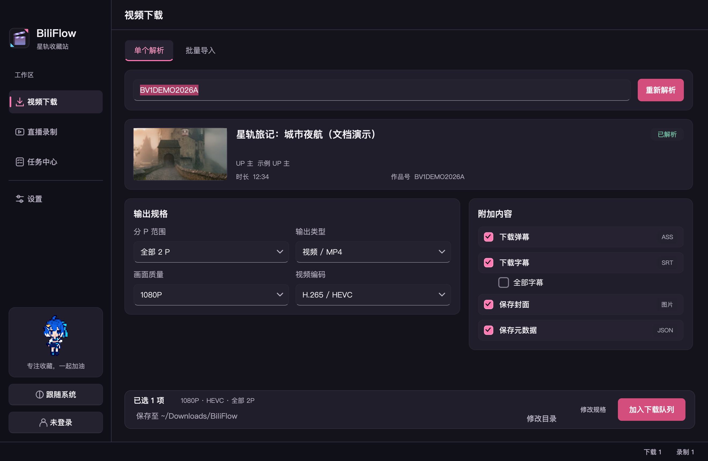
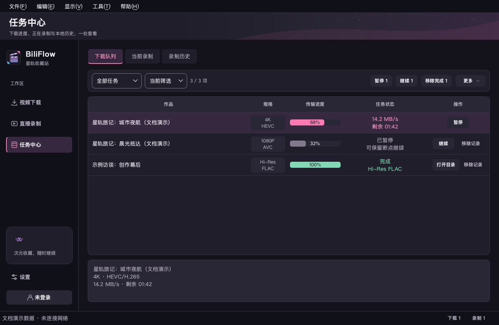
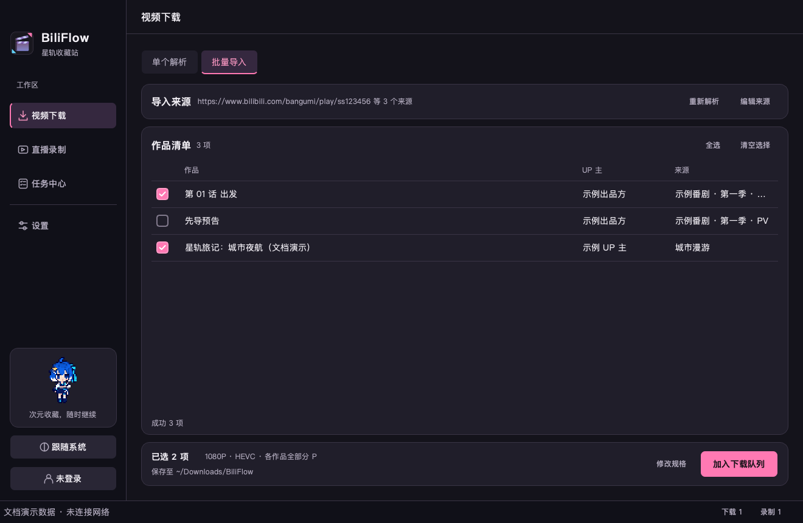
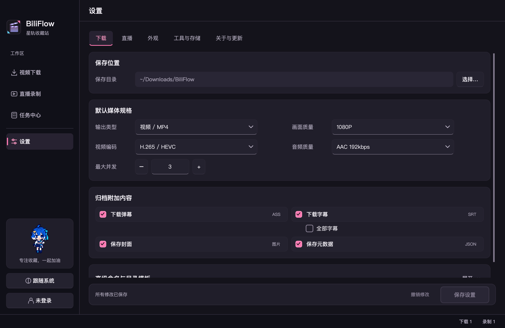
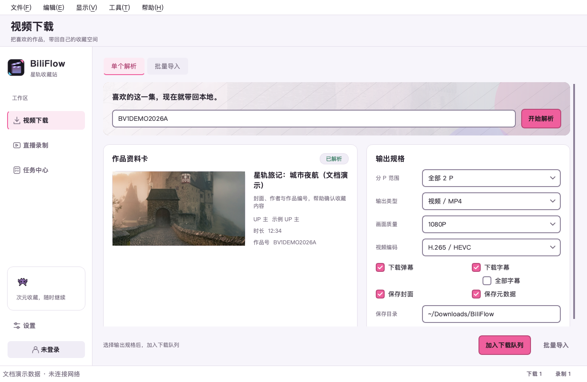
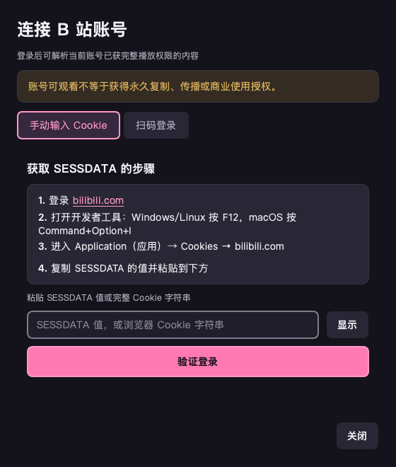
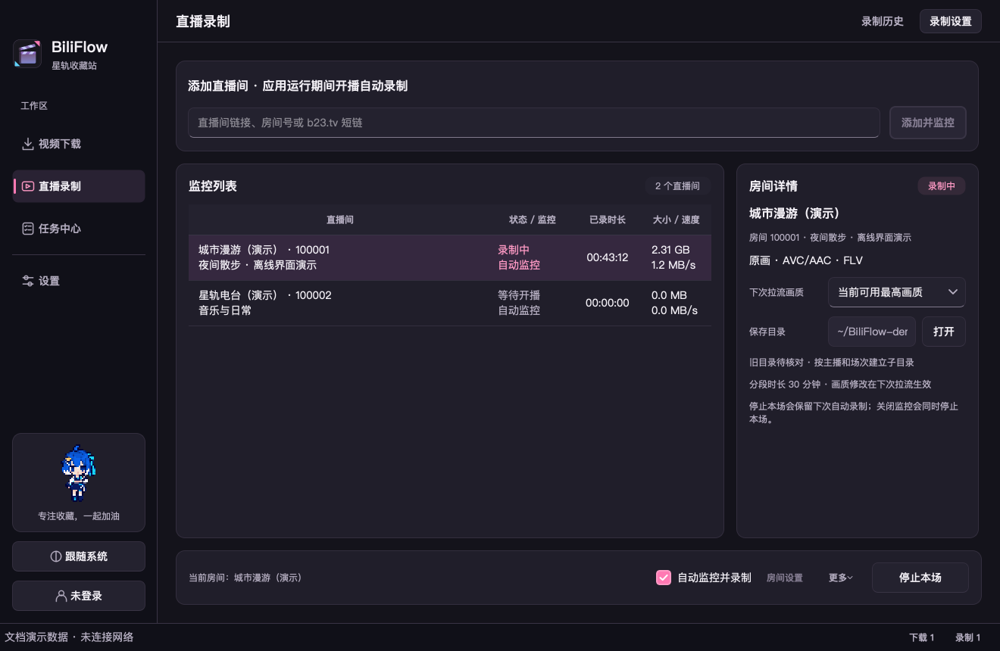

<p align="center">
  <a href="https://1008.si/">
    
  </a>
</p>

<h1 align="center">BiliFlow</h1>

<p align="center">
  Bilibili video downloads · Live recording · Local archiving<br>
  One desktop workspace for media you have permission to save.
</p>

<p align="center">
  <a href="README.md">简体中文</a> · <strong>English</strong>
</p>

<p align="center">
  <a href="https://1008.si/">Official website</a> ·
  <a href="https://github.com/itsVicOC/bilibili-downloader/releases/latest">Download stable release</a> ·
  <a href="docs/README.md">Documentation</a> ·
  <a href="CHANGELOG.md">Changelog</a> ·
  <a href="https://github.com/itsVicOC/bilibili-downloader/issues">Feedback</a>
</p>

<p align="center">
  <a href="https://1008.si/"></a>
  <a href="https://github.com/itsVicOC/bilibili-downloader/releases/latest"></a>
  <a href="https://github.com/itsVicOC/bilibili-downloader/releases"></a>
  <a href="https://github.com/itsVicOC/bilibili-downloader/actions/workflows/ci.yml"></a>
  <a href="docs/BUILDING.md"></a>
  <a href="LICENSE"></a>
</p>

**BiliFlow** (repository name: `bilibili-downloader`) is an open-source desktop tool for **Bilibili video downloads and live recording**, with both **GUI and CLI** modes. Download individual videos, multi-part videos, bangumi episodes, collections, series, and favorites; filter batches, pause and resume downloads, and organize video or audio alongside subtitles, danmaku, covers, and metadata.

Runs on Windows, macOS, and Linux. Prebuilt packages are available for Windows and Apple Silicon Macs; Linux users can run from source. Project code is licensed under MIT.

This README is available in English and Simplified Chinese. The current desktop interface and detailed documentation are primarily in Simplified Chinese; English links below point to those guides where applicable.

<p align="center">
  <picture>
    <source media="(prefers-color-scheme: dark)" srcset="docs/images/biliflow-dark.png">
    <source media="(prefers-color-scheme: light)" srcset="docs/images/biliflow-light.png">
    
  </picture>
</p>

**Quick navigation:** [Features](#features) · [Download and install](#download-and-install) · [Quick start](#quick-start) · [Screenshots](#screenshots) · [Supported sources](#supported-sources) · [Run from source](#run-from-source) · [FAQ](#faq) · [Documentation](#documentation) · [Contribute and support](#contribute-and-support)

> BiliFlow does not bypass membership, payment, regional restrictions, DRM, or account permissions. Permission to watch does not automatically grant permission to keep, redistribute, or commercially use a copy. Read the [copyright and usage policy](docs/COPYRIGHT.md) before downloading.

## Features

| Capability | What you can do |
|---|---|
| Multiple sources | Parse BV/AV IDs, bangumi `ep/ss/md` IDs, full Bilibili URLs, b23.tv short links, uploader collections/series, and favorites |
| Media quality and codecs | Select 240P–8K, HDR, Dolby Vision, AVC, HEVC, or AV1 when available, with a matching audio track |
| Local archives | Save MP4, M4A, or Hi-Res FLAC, plus ASS danmaku, SRT subtitles, covers, and JSON metadata |
| Persistent task center | Manage downloads, active recordings, and history; apply bulk actions to filtered or all tasks, undo record removal, and resume interrupted downloads after restarting |
| Live recording | Monitor rooms, record automatically or manually, split recordings, reconnect, browse history, and export MP4; see the [live recording guide](docs/LIVE_RECORDING.md) |
| Batch and multi-part downloads | Select individual or all parts, preview/filter batches, track or cancel metadata imports, retry failed entries, read paginated sources, deduplicate tasks, and run 1–8 concurrent downloads |
| Account login | Start with QR login or use the Cookie fallback; manage your account from the sidebar with username and avatar, retaining only allowed Cookie fields and preferring the system credential store |
| Cross-platform desktop UI | A PySide6 interface with a responsive layout down to 900×640 and automatic system light/dark themes |
| Themes and backgrounds | Compare Xinghe (pink/purple) and Qinghai (sky blue/soft rose) preview cards; preview cropping and adjust light/dark image visibility independently for each workspace before saving |
| Update checks and installation | Check at startup or manually, choose stable or beta channels, and verify/install/restart official macOS/Windows packages with recovery if startup fails |

`v0.8.3` adds the [official download mirror](https://1008.si/download/) for update discovery and package downloads, with GitHub fallback on network failures. Versions up to v0.8.2 use fixed GitHub endpoints; install v0.8.3 from the website to enable the mirror for future updates.

Automatic updates are available starting with `v0.8.1b1` and are currently a beta feature. First install a version that includes the updater manually. Check [Releases](https://github.com/itsVicOC/bilibili-downloader/releases) for stable and prerelease status.

The stable `v0.8.4` release fixes leaked danmaku coordinates, task status alignment, and settings backgrounds. It also improves character rendering, timestamp precision, and collision handling. Regenerate existing ASS/SRT files to apply these fixes; videos do not need to be downloaded again. See the [changelog](CHANGELOG.md#v084---2026-10-19) and [danmaku and subtitle guide](docs/USER_GUIDE.md#弹幕与字幕) (Chinese).

Downloads, live recording, and settings share consistent footer cards. Tabs and task tools retain readable surfaces over custom backgrounds, theme cards distinguish selection from keyboard focus, and record removal uses a quieter action style.

Available quality, codecs, audio tracks, and subtitles depend on the source, your account permissions, and Bilibili's API response.

## Download and install

Visit the **[BiliFlow website · 1008.si](https://1008.si/)** or **[download the latest stable release from GitHub](https://github.com/itsVicOC/bilibili-downloader/releases/latest)**. To try beta features, browse [all releases](https://github.com/itsVicOC/bilibili-downloader/releases) and look for the `Pre-release` label.

**Choose `full` for your first installation.** It includes a minimal LGPL FFmpeg built from pinned source and the matching live recording engine; Python is not required. The smaller `lite` package needs an external FFmpeg installation and, for live recording, a matching recorder engine.

Live recording is included in stable releases from `v0.8.0`. Configure engine paths under Settings → Tools & Storage (`设置 → 工具与存储`); see the [live recording guide](docs/LIVE_RECORDING.md).

| Platform | Release file | Notes |
|---|---|---|
| macOS 12+ · Apple Silicon | `BilibiliDownloader-macOS-full-<version>.dmg` | From v0.8.1; drag into Applications before opening |
| Windows 10/11 · x64 | `BilibiliDownloader-Windows-full-<version>-setup.exe` | From v0.8.1; per-user installation without administrator rights |
| macOS 12+ · Apple Silicon | `BilibiliDownloader-macOS-full-<version>.zip` | Portable archive; move the app into Applications |
| macOS 12+ · Apple Silicon | `BilibiliDownloader-macOS-lite-<version>.zip` | Install FFmpeg separately |
| Windows 10/11 · x64 | `BilibiliDownloader-Windows-full-<version>.zip` | Portable archive; extract the entire archive before running |
| Windows 10/11 · x64 | `BilibiliDownloader-Windows-lite-<version>.zip` | Install FFmpeg separately |
| Linux | No prebuilt package yet | Follow [Run from source](#run-from-source) |

EXE/DMG assets are available starting with the stable `v0.8.1` release. Windows installs into `%LOCALAPPDATA%\Programs\BiliFlow` by default and provides Start menu and system uninstall entries. Uninstall preserves configuration, task records, and user media. On macOS, install into Applications before launching. In-app updates continue using the corresponding full/lite ZIP.

For `lite`, source installations, or Linux, install FFmpeg using your package manager:

- macOS: `brew install ffmpeg`
- Windows: `winget install Gyan.FFmpeg`
- Ubuntu / Debian: `sudo apt install ffmpeg`

If FFmpeg is not on your PATH, select and check its executable under Settings → Tools & Storage. A custom path takes priority over the bundled version, so `full` users can also choose another FFmpeg build.

<details>
<summary>Verify your download</summary>

Each Release provides `SHA256SUMS.txt`. Replace `vX.Y.Z` with your downloaded version, then compare the result with the corresponding checksum:

```bash
# macOS / Linux
shasum -a 256 BilibiliDownloader-macOS-full-vX.Y.Z.zip
```

```powershell
# Windows PowerShell
Get-FileHash .\BilibiliDownloader-Windows-full-vX.Y.Z.zip -Algorithm SHA256
```

Releases also include the pinned FFmpeg source archive, a CycloneDX SBOM for each package, and the shared checksum file. Inside `full`, `FFMPEG-NOTICE.txt` records the actual binary checksum, build options, and license.

</details>

> macOS packages are not Apple-notarized by default. Any signed and notarized release will say so in its release notes. If macOS blocks an unnotarized version on first launch, use System Settings → Privacy & Security to allow it after confirming the package came from this repository's Releases page.

## Quick start

1. Open BiliFlow. For `lite` or source installations, first confirm FFmpeg is available.
2. Paste a BV/AV/ep ID, video or bangumi episode URL, or b23.tv short link into the video workspace, then click Parse (`开始解析`).
3. Choose the parts, quality, codec, video/audio output, and archive extras you want.
4. Click Add to queue (`加入下载队列`). Use the task center to view progress, pause, resume, and open the output folder.
5. For collections, favorites, and bangumi `ss/md` pages, open Batch import (`批量导入`), preview the source, and select the items to queue.
6. Review the copyright notice when creating your first download task. Tasks and temporary media files are created only after confirmation.

Single parsing and batch import use the same fixed output card, with media settings and the save directory on the left and Edit settings / Add to queue on the right. You can configure output before parsing; choices that remain available are preserved after parsing.

Some higher-quality streams, member content, or account-specific videos require login. BiliFlow uses only playback permissions your account already has. It stops if the API returns only a preview, regional restrictions, DRM, or no complete unencrypted stream.

See the [user guide](docs/USER_GUIDE.md) for task states, output templates, and configuration locations, or [troubleshooting](docs/TROUBLESHOOTING.md) for startup, parsing, FFmpeg, and login issues.

**Recording a live stream?** Add a room ID or live room URL on the Live recording page (`直播录制`) and enable monitoring. The task center shows active recordings and historical segments, with MP4 export. Monitoring requires the app to stay open; content missed while the app is closed, asleep, or offline cannot be recovered. See the [live recording guide](docs/LIVE_RECORDING.md).

## Screenshots

Video downloads and live recording share one workspace. Adding downloads keeps the current page open; the task center brings together the download queue, active recordings, and recording history. Settings cover downloads, live recording, tools/storage, and software updates.



<table>
  <tr>
    <td width="50%"></td>
    <td width="50%"></td>
  </tr>
  <tr>
    <td align="center">Batch import: source summary, item selection, and output confirmation</td>
    <td align="center">Download settings: templates, formats, and archive extras</td>
  </tr>
  <tr>
    <td width="50%"></td>
    <td width="50%"></td>
  </tr>
  <tr>
    <td align="center">Light theme follows your system settings</td>
    <td align="center">Login guidance and credential protection</td>
  </tr>
</table>

All screenshot titles, tasks, and account states use offline demo data. They contain no real Cookies, download URLs, or media content.



See [UI design and validation](docs/UI_DESIGN.md) for both themes, 900×640 / 1120×760 / 1320×860 layouts, and key interface states.

## Supported sources

| Source | Single-item parsing | Batch import | Notes |
|---|:---:|:---:|---|
| BV/AV IDs and standard video URLs | ✓ | ✓ | Multi-part videos supported |
| Bangumi `ep` episode | ✓ | ✓ | Requires complete playback permission |
| Bangumi `ss/md` season or media page | — | ✓ | Main episodes selected by default; PVs, extras, and specials can be added |
| Uploader collections and series | — | ✓ | Paginated browsing and filtering |
| Favorites | — | ✓ | Private or account-specific sources require login |
| b23.tv short links | ✓ | ✓ | Requires a network connection to resolve the URL |

Use the separate live recording workspace for live room links. International Bilibili, courses, Watch Later, dynamic feeds, DRM, regional proxy resolution, and any bypass of payment, membership, or account permissions are outside the supported scope. Actual formats and subtitles depend on the source, account permissions, and API response.

## Run from source

Requires Python 3.10–3.12 and FFmpeg:

```bash
git clone https://github.com/itsVicOC/bilibili-downloader.git
cd bilibili-downloader
python -m venv .venv
source .venv/bin/activate
python -m pip install -c constraints.txt -e ".[dev]"
python -m bilibili_downloader
```

On Windows PowerShell, activate the environment with `.\.venv\Scripts\Activate.ps1` instead.

<details>
<summary>Enable live recording in a source installation</summary>

Build the matching Rust / Mesio engine after installing the Rust toolchain:

```bash
cargo build --release --locked --manifest-path native/recorder/Cargo.toml
```

The app detects `native/recorder/target/release/biliflow-recorder` automatically (`.exe` on Windows). See [live recording development](docs/LIVE_RECORDING.md#开发与验证) for the validated toolchain version, dependencies, and complete procedure.

</details>

### CLI examples

```bash
# Inspect metadata without downloading media
python -m bilibili_downloader test BV1GJ411x7h7

# Download 1080P video with danmaku and subtitles
python -m bilibili_downloader download BV1GJ411x7h7 \
  --quality 80 --danmaku --subtitle

# Save audio only
python -m bilibili_downloader download BV1GJ411x7h7 --audio-only

# Download a bangumi episode your account can play in full
python -m bilibili_downloader download ep123 --quality 80

# Seasons contain main episodes by default; explicitly include extras
python -m bilibili_downloader download \
  "https://www.bilibili.com/bangumi/play/ss123" \
  --include-extras

# Download an accessible collection with archive extras
python -m bilibili_downloader download \
  "https://space.bilibili.com/123/lists/456?type=season" \
  --quality 80 \
  --output ./downloads \
  --danmaku \
  --subtitle \
  --cover \
  --metadata \
  --path-template "{author}/{title}{part_suffix}" \
  --page all \
  --codec 12
```

Run `python -m bilibili_downloader --help` or read the [CLI guide](docs/USER_GUIDE.md#cli) for all options.

The IDs `ep123`, `ss123`, and numbers in the collection URL are placeholders; replace them with your source. The first interactive CLI download asks for copyright confirmation. Non-interactive environments must explicitly pass `--acknowledge-copyright`.

## FAQ

<details>
<summary>Should I choose full or lite? Do I need Python?</summary>

Prebuilt packages do not require Python. Choose `full` for a first installation: FFmpeg and the live recording engine are included. Choose `lite` if you prefer to manage those tools yourself. Python is needed only when running from source.

</details>

<details>
<summary>Can I use it without logging in? Why is 4K, HDR, or 8K missing?</summary>

Public videos that can be played in full can be parsed and downloaded without login. Higher quality, member content, and account-specific videos depend on the source and your account permissions. BiliFlow lists only formats returned by the API and does not unlock unauthorized content. See [quality troubleshooting](docs/TROUBLESHOOTING.md#看不到高画质或指定编码).

</details>

<details>
<summary>Do interrupted downloads have to start over?</summary>

Tasks and partial downloads are stored locally. Restart the app and resume the paused task in the task center. Keep the task database and the output directory's `.biliflow-parts/` folder; clearing the cache removes unfinished download data.

</details>

<details>
<summary>What about Intel Macs, Linux, or phones?</summary>

Current prebuilt packages target Apple Silicon Macs and Windows x64. Linux and Intel Mac users can try running from source; Intel Macs have no prebuilt package, and compatibility must be verified on your system. The project does not currently provide Android or iOS clients.

</details>

<details>
<summary>What if the app will not open or cannot find FFmpeg?</summary>

First check that you extracted the correct archive completely. For `full`, verify the Release checksums. For `lite` or source installations, select the FFmpeg executable under Settings → Tools & Storage. See [troubleshooting](docs/TROUBLESHOOTING.md) for macOS first-launch and Windows security prompts.

</details>

## Documentation

Detailed guides are currently in Simplified Chinese.

| Document | Audience | Contents |
|---|---|---|
| [Documentation hub](docs/README.md) | Everyone | Installation, usage, troubleshooting, development, and release guides |
| [User guide](docs/USER_GUIDE.md) | Users | GUI, CLI, login, tasks, configuration, and local data |
| [Live recording](docs/LIVE_RECORDING.md) | Users, developers | Monitoring, recording history, engine setup, and validation scope |
| [UI design and validation](docs/UI_DESIGN.md) | Users, developers | Themes, responsive layouts, interface states, and screenshot index |
| [Troubleshooting](docs/TROUBLESHOOTING.md) | Users | Startup, parsing, formats, FFmpeg, login, and recovery |
| [Copyright and usage policy](docs/COPYRIGHT.md) | Everyone | Permissions, prohibited uses, and rights-holder feedback |
| [Building and releasing](docs/BUILDING.md) | Developers | Environment, tests, screenshots, packaging, and release process |
| [Contributing](CONTRIBUTING.md) | Contributors | Issues, branches, code quality, and pull requests |
| [Security policy](SECURITY.md) | Researchers | Vulnerability reporting and credential handling |
| [Third-party notices](THIRD_PARTY_NOTICES.md) | Release maintainers | Images, icons, FFmpeg, and licenses |
| [Changelog](CHANGELOG.md) | Everyone | Changes and fixes by release |

## Development checks

```bash
python -m compileall -q bilibili_downloader tests scripts
pytest -q
ruff check bilibili_downloader tests packaging_hooks scripts
git diff --check
```

For changes to packaging, resource paths, or dependencies, also run:

```bash
pyinstaller --noconfirm --clean BilibiliDownloader.spec
```

See [Building and releasing](docs/BUILDING.md) for the project structure, screenshot generation, and complete release process.

## Contribute and support

If BiliFlow helps you, give it a Star on [GitHub](https://github.com/itsVicOC/bilibili-downloader), or share the [website](https://1008.si/) and repository with others looking for desktop media downloads and archiving.

- **Report bugs or suggest features:** check [troubleshooting](docs/TROUBLESHOOTING.md) and [existing issues](https://github.com/itsVicOC/bilibili-downloader/issues), then [open an issue](https://github.com/itsVicOC/bilibili-downloader/issues/new). Include your version, platform, and reproduction steps; remove Cookies, signed playback URLs, and personal information.
- **Improve code, documentation, or translations:** read the [contributing guide](CONTRIBUTING.md) and submit a pull request. Keep features, installation instructions, and links synchronized between both READMEs.
- **Report vulnerabilities:** follow the private reporting channel in the [security policy](SECURITY.md).

Thanks to the contributors behind [PySide6 / Qt](https://doc.qt.io/qtforpython-6/), [FFmpeg](https://ffmpeg.org/), [Mesio / rust-srec](https://github.com/hua0512/rust-srec), and the other open-source dependencies. See [third-party notices](THIRD_PARTY_NOTICES.md) for artwork and licenses.

## Privacy and disclaimer

- The app does not send login credentials to project maintainers, project servers, or media CDNs. Cookies are sent only to trusted Bilibili API and web domains.
- Only allowed Cookie fields are retained, preferably in the system credential store. If that store is unavailable, credentials stay in process memory and you must log in again after restarting.
- Logs, task databases, metadata, and documentation screenshots should never contain valid Cookies or signed playback URLs.
- This project is not affiliated with, authorized by, partnered with, or endorsed by Bilibili.
- Prefer the official client's caching options where available, and follow local law, platform terms, and rights-holder permissions.

## License

Project code is licensed under the [MIT License](LICENSE). Interface assets and bundled FFmpeg retain their own licenses; see [THIRD_PARTY_NOTICES.md](THIRD_PARTY_NOTICES.md).
