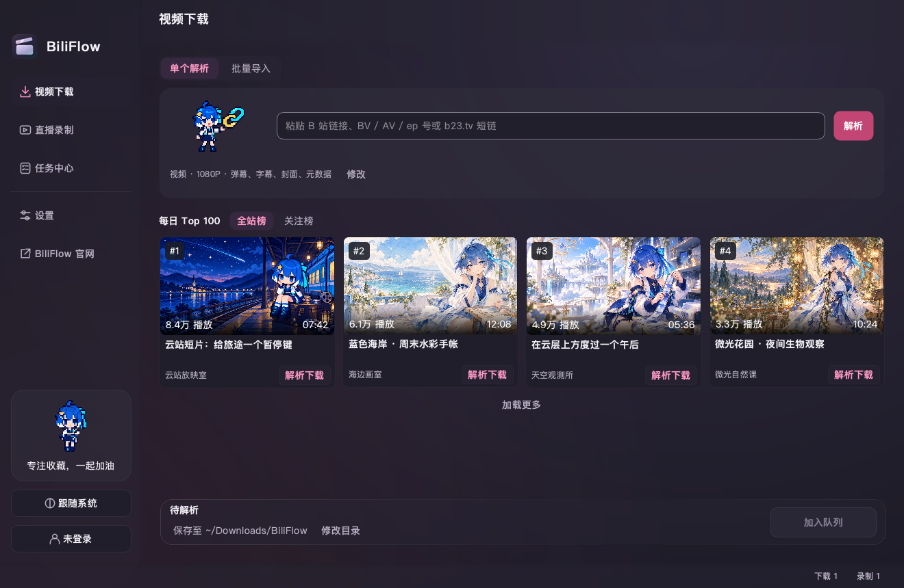
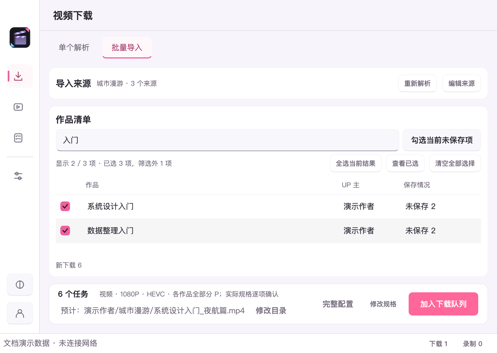
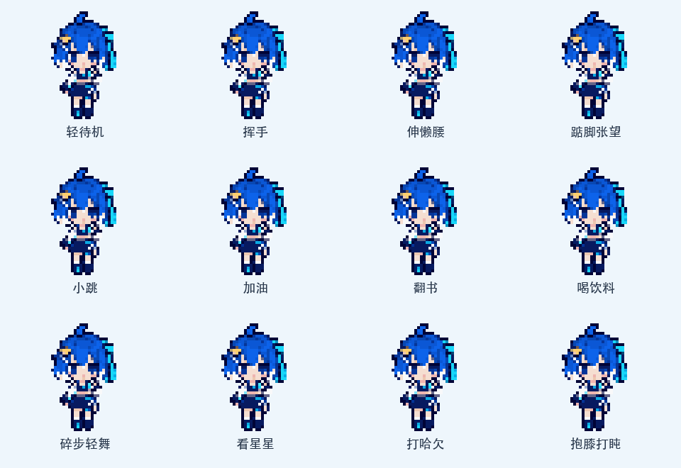
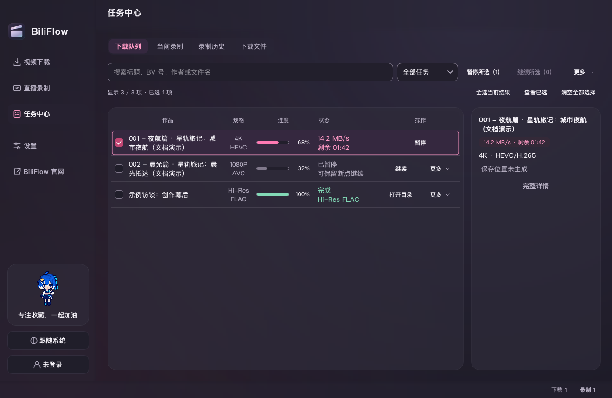
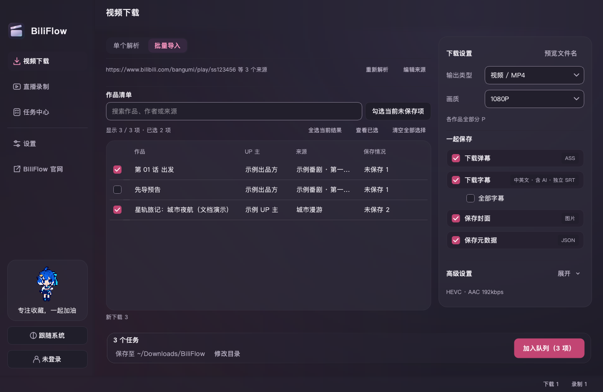
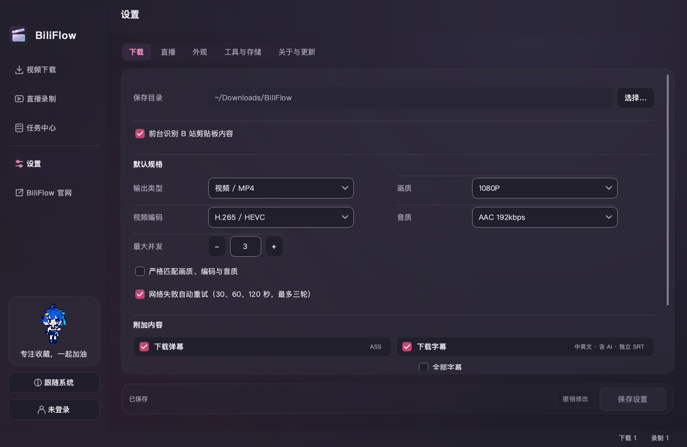
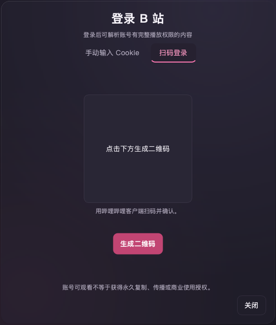
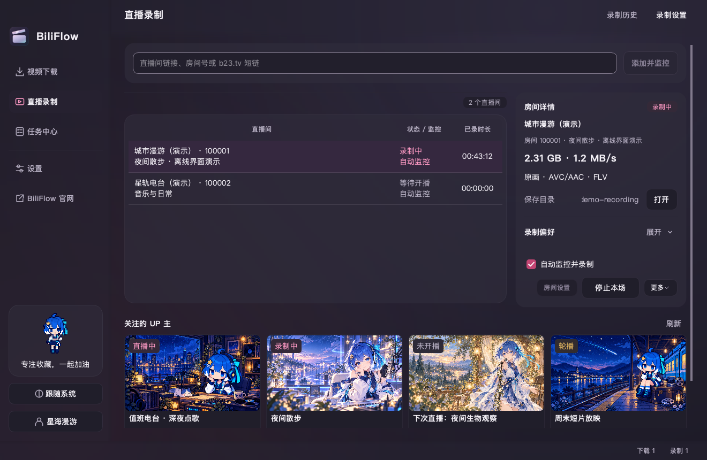

<p align="center">
  <a href="https://1008.si/">
    
  </a>
</p>

<h1 align="center">BiliFlow</h1>

<p align="center">
  Bilibili 動画のダウンロード · ライブ録画 · ローカルアーカイブ<br>
  保存する権利のあるメディアを、ひとつのデスクトップワークスペースで。
</p>

<p align="center">
  <a href="README.md">简体中文</a> · <a href="README.en.md">English</a> · <strong>日本語</strong>
</p>

<p align="center">
  <a href="https://1008.si/">公式サイト</a> ·
  <a href="https://github.com/itsVicOC/bilibili-downloader/releases/latest">安定版をダウンロード</a> ·
  <a href="docs/README.md">ドキュメント</a> ·
  <a href="CHANGELOG.md">変更履歴</a> ·
  <a href="https://github.com/itsVicOC/bilibili-downloader/issues">フィードバック</a>
</p>

<p align="center">
  <a href="https://1008.si/"></a>
  <a href="https://github.com/itsVicOC/bilibili-downloader/releases/latest"></a>
  <a href="https://github.com/itsVicOC/bilibili-downloader/releases"></a>
  <a href="https://github.com/itsVicOC/bilibili-downloader/actions/workflows/ci.yml"></a>
  <a href="docs/BUILDING.md"></a>
  <a href="LICENSE"></a>
</p>

**BiliFlow**（リポジトリ名: `bilibili-downloader`）は、**Bilibili 動画のダウンロードとライブ録画**のためのオープンソースのデスクトップツールで、**GUI と CLI** の両方のモードを備えています。単体の動画、複数パートの動画、番組（アニメ）のエピソード、コレクション、シリーズ、お気に入りをダウンロードできます。バッチの絞り込み、ダウンロードの一時停止と再開が可能で、動画や音声を字幕、弾幕、カバー画像、メタデータとあわせて整理できます。

Windows、macOS、Linux で動作します。Windows と Apple Silicon Mac 向けにはビルド済みパッケージが用意されており、Linux ではソースから実行できます。プロジェクトのコードは MIT ライセンスです。

この README は英語と簡体字中国語で提供されています。現在のデスクトップインターフェースと詳細なドキュメントは主に簡体字中国語で書かれており、以下のリンクは該当する場合それらのガイドを指しています。

<p align="center">
  <picture>
    <source media="(prefers-color-scheme: dark)" srcset="docs/images/biliflow-dark.png">
    <source media="(prefers-color-scheme: light)" srcset="docs/images/biliflow-light.png">
    
  </picture>
</p>

**クイックナビゲーション:** [機能](#機能) · [ダウンロードとインストール](#ダウンロードとインストール) · [クイックスタート](#クイックスタート) · [スクリーンショット](#スクリーンショット) · [対応ソース](#対応ソース) · [ソースから実行](#ソースから実行) · [よくある質問](#よくある質問) · [ドキュメント](#ドキュメント) · [貢献とサポート](#貢献とサポート) · [相互リンク](#相互リンク)

> BiliFlow は、会員制限、支払い、地域制限、DRM、アカウント権限を回避しません。視聴が許可されていても、コピーを保存、再配布、商用利用する権利が自動的に得られるわけではありません。ダウンロードの前に[著作権と利用ポリシー](docs/COPYRIGHT.md)をお読みください。

## 機能

| 機能 | できること |
|---|---|
| 多様なソース | BV/AV ID、番組の `ep/ss/md` ID、Bilibili の完全な URL、b23.tv 短縮リンク、投稿者のコレクション／シリーズ、お気に入りを解析します |
| 画質とコーデック | 利用可能な場合は 240P–8K、HDR、Dolby Vision、AVC、HEVC、AV1 を選択でき、対応する音声トラックも選ばれます |
| ローカルアーカイブ | MP4、M4A、Hi-Res FLAC に加え、ASS 弾幕、SRT 字幕、カバー画像、JSON メタデータを保存します |
| 永続的なタスクセンター | ダウンロード、進行中の録画、履歴を管理します。絞り込んだタスクまたはすべてのタスクに一括操作を適用し、記録の削除を元に戻し、再起動後に中断したダウンロードを再開できます |
| ライブ録画 | 配信ルームを監視し、自動または手動で録画、再接続し、セッションを自動またはオンデマンドで 1 つの MP4 に結合します。グローバルまたはルームごとのディレクトリを使用できます。[ライブ録画ガイド](docs/LIVE_RECORDING.md)を参照してください |
| バッチと複数パートのダウンロード | パートの検索とチェック、範囲の追加、絞り込みをまたいだ選択の保持、バッチのプレビュー、メタデータ取り込みの追跡やキャンセル、失敗した項目の再試行、ページ分割されたソースの読み込み、タスクの重複排除、1–8 件の同時ダウンロードが可能です |
| アカウントログイン | QR ログインで始めるか、Cookie による代替手段を使用します。サイドバーからユーザー名とアバター付きでアカウントを管理でき、許可された Cookie フィールドのみを保持し、システムの資格情報ストアを優先して使用します |
| クロスプラットフォームのデスクトップ UI | 900×640 までのレスポンシブレイアウト、手動のライト／ダークモード、システムテーマの自動切り替えを備えた PySide6 インターフェースです |
| テーマと背景 | Xinghe と Qinghai のテーマ。12 種類の Xiao Liu の壁紙またはカスタム画像を使用でき、大きなプレビュー、フィルター、ドラッグ＆ドロップでの取り込み、ワークスペースごとのライト／ダーク別の表示設定に対応しています |
| Xiao Liu コンパニオン | 12 種類のピクセルアニメーションが 5 つのローカル時間帯に合わせて変化し、フォアグラウンドで 15–30 秒操作がないとフルアクションを再生し、時間帯に応じたキャプションを表示します。[アニメーションのプレビュー](docs/MASCOT_DESIGN.md) |
| 更新の確認とインストール | 起動時または手動で確認し、安定版またはベータ版のチャンネルを選択して、公式の macOS/Windows パッケージを検証・インストール・再起動できます。起動に失敗した場合の復旧機能もあります |

`v0.8.3` では、更新の検出とパッケージのダウンロード用に[公式ダウンロードミラー](https://1008.si/download/)が追加され、ネットワーク障害時には GitHub にフォールバックします。v0.8.2 までのバージョンは固定の GitHub エンドポイントを使用します。今後の更新でミラーを有効にするには、サイトから v0.8.3 をインストールしてください。

自動更新は `v0.8.1b1` から利用可能で、現在はベータ機能です。まず、アップデーターを含むバージョンを手動でインストールしてください。安定版とプレリリースの状況は [Releases](https://github.com/itsVicOC/bilibili-downloader/releases) で確認してください。

安定版パッチ `v0.8.13` では、海外 CDN からのダウンロードや再開時に発生する HTTP 403 エラーを修正しました（#33）。範囲を限定したリクエストですべてのチャンクを検証します。音声／動画の完全なダウンロード、デコード、再開したファイルの整合性は、米国の Windows と Linux のランナーで検証済みです。アカウント、設定、タスク、メディアの互換性は維持されています。[安定版 0.8.13 をダウンロード](https://github.com/itsVicOC/bilibili-downloader/releases/tag/v0.8.13) · [変更履歴](CHANGELOG.md#v0813---2026-11-18) · [海外 CDN の検証](docs/ISSUE33_RANGE_VALIDATION.md) · [UI の検証](docs/UI_DETAIL_POLISH.md)（中国語）。

パス操作がダウンロードディレクトリの横に配置され、タスクビューでは行全体がハイライトされるようになり、録画履歴のセッションはすべてのメディアファイルを残したまま元に戻せる形で削除できるようになりました。フォアグラウンドでのクリップボード認識はデフォルトで有効で、解析の前に確認が必要です。自動的にダウンロードをキューに追加することはありません。アカウント、設定、壁紙、タスク、メディアの互換性は維持されています。[ユーザーガイド](docs/USER_GUIDE.md)、[ウィンドウ復元の検証](docs/FLUENT_V4_VALIDATION.md)、[操作の検証](docs/FLUENT_V5_VALIDATION.md)（中国語）を参照してください。

## ダウンロードとインストール

**`v0.9.0b6` プレリリース**では、ダウンロードページのランキングがオンデマンド読み込みに対応した Daily Top 100 に拡張されました。ログインすると、フォロー中のクリエイターの動画を公開日時または再生数で並べ替えたり、ライブワークスペースでフォロー中のチャンネルを確認したりできます。既存のインストールは、ベータ版を含むチャンネルから更新できます。[0.9.0 Beta 6 をダウンロード](https://github.com/itsVicOC/bilibili-downloader/releases/tag/v0.9.0b6) · [変更履歴](CHANGELOG.md#v090b6---2026-11-23)

**安定版 `v0.8.13`:** 海外 CDN での HTTP 403 によるダウンロードと再開の失敗を修正し、ストリーム全体が検証された後にのみ録画を完了とするようにしました。字幕の検証、4:3 表示用のコピー、コレクションワークスペースは引き続き利用できます。[安定版をダウンロード](https://github.com/itsVicOC/bilibili-downloader/releases/tag/v0.8.13) · [検証記録](docs/BUILDING.md)（中国語）。どちらの更新チャンネルからもアップグレードできます。

永続的なメディアの再利用、添付ファイルの個別修復、厳密なメディア照合、キューとバッチの検索、カスタムのパート範囲、ネットワークの自動再試行、メディアの検査、ディレクトリの再リンクを含みます。既存の設定とキューに入った出力のスナップショットの互換性は維持されています。チェックした項目は絞り込みをまたいで保持され、非表示の選択数も表示されます。結果はメディア、仕様、添付ファイルに分けて表示され、命名フィールドは中国語での検索に対応しています。[ユーザーガイド](docs/USER_GUIDE.md#下载与归档优化) · [ワークフローの検証](docs/WORKFLOW_POLISH_VALIDATION.md)（ネイティブとの比較、ペアでのパフォーマンス結果、ベータ段階のチェック範囲を含む）。



**[BiliFlow 公式サイト · 1008.si](https://1008.si/)** にアクセスするか、**[GitHub から最新の安定版をダウンロード](https://github.com/itsVicOC/bilibili-downloader/releases/latest)** してください。ベータ機能を試すには、[すべてのリリース](https://github.com/itsVicOC/bilibili-downloader/releases)を開き、`Pre-release` ラベルの付いたものを探してください。

**初めてインストールする場合は `full` を選んでください。** 固定されたソースからビルドされた最小構成の LGPL FFmpeg と、対応するライブ録画エンジンが含まれており、Python は不要です。より小さい `lite` パッケージでは、外部の FFmpeg のインストールが必要で、ライブ録画には対応する録画エンジンも必要です。

ライブ録画は `v0.8.0` 以降の安定版に含まれています。エンジンのパスは 設定 → ツールとストレージ（`设置 → 工具与存储`）で設定します。[ライブ録画ガイド](docs/LIVE_RECORDING.md)を参照してください。

| プラットフォーム | リリースファイル | 備考 |
|---|---|---|
| macOS 12+ · Apple Silicon | `BilibiliDownloader-macOS-full-<version>.dmg` | v0.8.1 から。開く前に Applications にドラッグしてください |
| Windows 10/11 · x64 | `BilibiliDownloader-Windows-full-<version>-setup.exe` | v0.8.1 から。管理者権限なしのユーザー単位のインストールです |
| macOS 12+ · Apple Silicon | `BilibiliDownloader-macOS-full-<version>.zip` | ポータブルアーカイブ。アプリを Applications に移動してください |
| macOS 12+ · Apple Silicon | `BilibiliDownloader-macOS-lite-<version>.zip` | FFmpeg を別途インストールしてください |
| Windows 10/11 · x64 | `BilibiliDownloader-Windows-full-<version>.zip` | ポータブルアーカイブ。実行前にアーカイブ全体を展開してください |
| Windows 10/11 · x64 | `BilibiliDownloader-Windows-lite-<version>.zip` | FFmpeg を別途インストールしてください |
| Linux | ビルド済みパッケージはまだありません | [ソースから実行](#ソースから実行)に従ってください |

EXE/DMG アセットは安定版 `v0.8.1` リリースから提供されています。Windows ではデフォルトで `%LOCALAPPDATA%\Programs\BiliFlow` にインストールされ、スタートメニューとシステムのアンインストール項目が用意されます。アンインストールしても設定、タスク記録、ユーザーのメディアは保持されます。macOS では、起動する前に Applications にインストールしてください。アプリ内の更新では、引き続き対応する full/lite の ZIP が使用されます。

`lite`、ソースからのインストール、または Linux の場合は、パッケージマネージャーで FFmpeg をインストールしてください:

- macOS: `brew install ffmpeg`
- Windows: `winget install Gyan.FFmpeg`
- Ubuntu / Debian: `sudo apt install ffmpeg`

FFmpeg が PATH にない場合は、設定 → ツールとストレージ で実行ファイルを選択して確認してください。カスタムパスはバンドル版より優先されるため、`full` のユーザーも別の FFmpeg ビルドを選択できます。

<details>
<summary>ダウンロードを検証する</summary>

各 Release には `SHA256SUMS.txt` が用意されています。`vX.Y.Z` をダウンロードしたバージョンに置き換え、結果を対応するチェックサムと比較してください:

```bash
# macOS / Linux
shasum -a 256 BilibiliDownloader-macOS-full-vX.Y.Z.zip
```

```powershell
# Windows PowerShell
Get-FileHash .\BilibiliDownloader-Windows-full-vX.Y.Z.zip -Algorithm SHA256
```

Release には、固定された FFmpeg のソースアーカイブ、各パッケージの CycloneDX SBOM、共通のチェックサムファイルも含まれています。`full` の中にある `FFMPEG-NOTICE.txt` には、実際のバイナリのチェックサム、ビルドオプション、ライセンスが記録されています。

</details>

> macOS パッケージは、デフォルトでは Apple の公証を受けていません。署名と公証を受けたリリースがある場合は、そのリリースノートに明記されます。未公証のバージョンが初回起動時に macOS によってブロックされた場合は、パッケージがこのリポジトリの Releases ページから入手したものであることを確認したうえで、システム設定 → プライバシーとセキュリティ から許可してください。

## クイックスタート

1. BiliFlow を開きます。`lite` またはソースからのインストールの場合は、まず FFmpeg が利用可能であることを確認してください。
2. BV/AV/ep ID、動画または番組エピソードの URL、b23.tv 短縮リンクを動画ワークスペースに貼り付け、解析（`解析`）をクリックします。
3. 必要なパート、画質、コーデック、動画／音声の出力、アーカイブの追加項目を選択します。
4. キューに追加（`加入队列`）をクリックします。タスクセンターで進捗の確認、一時停止、再開、出力フォルダーを開く操作ができます。
5. コレクション、お気に入り、番組の `ss/md` ページの場合は、バッチ取り込み（`批量导入`）を開き、ソースをプレビューして、キューに追加する項目を選択します。
6. 最初のダウンロードタスクを作成するときに、著作権に関する注意事項を確認してください。タスクと一時的なメディアファイルは、確認後にのみ作成されます。

単体の解析とバッチ取り込みは同じ固定の出力カードを使用し、左側にメディア設定と保存ディレクトリ、右側に 設定を編集 / キューに追加 があります。解析の前に出力を設定でき、引き続き利用可能な選択は解析後も保持されます。

一部の高画質ストリーム、会員向けコンテンツ、アカウント固有の動画にはログインが必要です。BiliFlow は、アカウントがすでに持っている再生権限のみを使用します。API がプレビューのみ、地域制限、DRM、または完全な暗号化されていないストリームなしを返した場合は停止します。

サイドバー（`BiliFlow 官网`）からプロジェクトのサイトを開けます。Daily Top 100（`每日 Top 100`）は、ダウンロード入力欄の下に 1 画面分の動画から表示されます。最後までスクロールするか、さらに読み込む（`加载更多`）を選択すると続きを閲覧できます。カバーまたはタイトルを選択するとブラウザで動画が開き、解析してダウンロード（`解析下载`）を使うとダウンロード設定を選択できます。ログインすると、フォロー中ランキングとライブワークスペースでフォロー中のチャンネルを表示できます。それらのカードには、現在の配信を録画したり監視を有効にしたりするボタンがあります。

タスクの状態、出力テンプレート、設定の保存場所については[ユーザーガイド](docs/USER_GUIDE.md)を、起動、解析、FFmpeg、ログインの問題については[トラブルシューティング](docs/TROUBLESHOOTING.md)を参照してください。

**ライブ配信を録画しますか？** ライブ録画ページ（`直播录制`）でルーム ID またはライブルームの URL を追加し、監視を有効にします。タスクセンターには進行中の録画と過去のセグメントが表示され、MP4 でエクスポートできます。監視にはアプリを開いたままにしておく必要があり、アプリが閉じている、スリープ中、またはオフラインの間に逃したコンテンツは復元できません。[ライブ録画ガイド](docs/LIVE_RECORDING.md)を参照してください。

**ウィンドウを閉じた後もタスクを実行し続けるには:** macOS では、赤い閉じるボタンと `⌘W` はウィンドウを閉じるだけです。Dock アイコンをクリックすると復元でき、終了するには `⌘Q` またはアプリメニューを使用します。Windows では、閉じるときに システムトレイに最小化 または 終了 を選択でき、選択を記憶させることもできます。これは 設定 → 外観 → ウィンドウ（`设置 → 外观 → 窗口`）で変更できます。トレイアイコンをクリックするとウィンドウが復元され、コンテキストメニューから終了できます。ダウンロード、ライブ監視、録画、エクスポートは、ウィンドウが閉じているときやトレイにあるときも継続します。終了時には進行中のタスクを確認し、クリーンアップが完了するまで待機します。

## スクリーンショット

開発ブランチでは、共通のダウンロード設定、より分かりやすいコンテンツレイアウト、より温かみのあるウェルカム画面と空の状態が導入されています。以下の主なスクリーンショットはこの開発版 UI を示しています。[詳細な比較と状態一覧](docs/images/ui-detail/index.html)と[検証メモ](docs/UI_DETAIL_POLISH.md)を参照してください。

Xiao Liu は 5 つのローカル時間帯に合わせて、フォアグラウンドで 15–30 秒操作がないと異なるアクションを再生します。アプリが非表示、最小化、または非アクティブの間、アニメーションは一時停止します。



動画のダウンロードとライブ録画はひとつのワークスペースを共有します。ダウンロードを追加しても現在のページは開いたままで、タスクセンターにはダウンロードキュー、進行中の録画、録画履歴がまとめられています。設定では、ダウンロード、ライブ録画、ツール／ストレージ、ソフトウェアの更新を扱います。



<table>
  <tr>
    <td width="50%"></td>
    <td width="50%"></td>
  </tr>
  <tr>
    <td align="center">バッチ取り込み: ソースの概要、項目の選択、出力の確認</td>
    <td align="center">ダウンロード設定: テンプレート、形式、アーカイブの追加項目</td>
  </tr>
  <tr>
    <td width="50%"></td>
    <td width="50%"></td>
  </tr>
  <tr>
    <td align="center">ライトテーマはシステム設定に従います</td>
    <td align="center">ログインの案内と資格情報の保護</td>
  </tr>
</table>

すべてのスクリーンショットのタイトル、タスク、アカウントの状態にはオフラインのデモデータを使用しています。実際の Cookie、ダウンロード URL、メディアコンテンツは含まれていません。



両方のテーマ、900×640 / 1120×760 / 1320×860 のレイアウト、主要なインターフェースの状態については、[UI デザインと検証](docs/UI_DESIGN.md)を参照してください。

## 対応ソース

| ソース | 単体の解析 | バッチ取り込み | 備考 |
|---|:---:|:---:|---|
| BV/AV ID と通常の動画 URL | ✓ | ✓ | 複数パートの動画に対応 |
| 番組の `ep` エピソード | ✓ | ✓ | 完全な再生権限が必要です |
| 番組の `ss/md` シーズンまたはメディアページ | — | ✓ | 本編エピソードがデフォルトで選択されます。PV、おまけ、特別編も追加できます |
| 投稿者のコレクションとシリーズ | — | ✓ | ページ分割での閲覧と絞り込み |
| お気に入り | — | ✓ | 非公開またはアカウント固有のソースにはログインが必要です |
| b23.tv 短縮リンク | ✓ | ✓ | URL の解決にネットワーク接続が必要です |

ライブルームのリンクには、別のライブ録画ワークスペースを使用してください。国際版 Bilibili、講座、後で見る、動態フィード、DRM、地域プロキシによる解決、および支払い、会員、アカウント権限の回避は、サポート対象外です。実際の形式と字幕は、ソース、アカウント権限、API のレスポンスによって異なります。

## ソースから実行

Python 3.11–3.12 と FFmpeg が必要です。Pillow 13 のセキュリティ修正を利用するため、最小バージョンは 3.11 になりました。ビルド済みアプリケーションには Python が同梱されているため、別途 Python をアップグレードする必要はありません:

```bash
git clone https://github.com/itsVicOC/bilibili-downloader.git
cd bilibili-downloader
python -m venv .venv
source .venv/bin/activate
python -m pip install -c constraints.txt -e ".[dev]"
python -m bilibili_downloader
```

Windows PowerShell では、代わりに `.\.venv\Scripts\Activate.ps1` で環境を有効化してください。

<details>
<summary>ソースからのインストールでライブ録画を有効にする</summary>

Rust ツールチェーンをインストールした後、対応する Rust / Mesio エンジンをビルドします:

```bash
cargo build --release --locked --manifest-path native/recorder/Cargo.toml
```

アプリは `native/recorder/target/release/biliflow-recorder`（Windows では `.exe`）を自動的に検出します。検証済みのツールチェーンのバージョン、依存関係、完全な手順については、[ライブ録画の開発](docs/LIVE_RECORDING.md#开发与验证)を参照してください。

</details>

### CLI の例

```bash
# Inspect metadata without downloading media
python -m bilibili_downloader test BV1GJ411x7h7

# Download 1080P video with danmaku and subtitles
# Save available Chinese and English tracks (including AI) as separate SRT files; use --all-subtitles for every language.
python -m bilibili_downloader download BV1GJ411x7h7 \
  --quality 80 --danmaku --subtitle

# Display the complete picture at 4:3 without cropping or re-encoding
python -m bilibili_downloader download BV1Syxv6JEa6 --aspect-ratio 4:3 --all-subtitles

# Save audio only
python -m bilibili_downloader download BV1GJ411x7h7 --audio-only

# Download a bangumi episode your account can play in full
python -m bilibili_downloader download ep123 --quality 80

# Seasons contain main episodes by default; explicitly include extras
python -m bilibili_downloader download \
  "https://www.bilibili.com/bangumi/play/ss123" \
  --include-extras

# Download an accessible collection with archive extras
python -m bilibili_downloader download \
  "https://space.bilibili.com/123/lists/456?type=season" \
  --quality 80 \
  --output ./downloads \
  --danmaku \
  --subtitle \
  --cover \
  --metadata \
  --path-template "{author}/{title}{part_suffix}" \
  --page all \
  --codec 12
```

すべてのオプションについては、`python -m bilibili_downloader --help` を実行するか、[CLI ガイド](docs/USER_GUIDE.md#cli)をお読みください。

ID の `ep123`、`ss123`、およびコレクション URL 内の数字はプレースホルダーです。お使いのソースに置き換えてください。CLI での最初の対話的なダウンロードでは、著作権の確認が求められます。非対話的な環境では、`--acknowledge-copyright` を明示的に指定する必要があります。

## よくある質問

<details>
<summary>full と lite のどちらを選ぶべきですか？ Python は必要ですか？</summary>

ビルド済みパッケージには Python は不要です。初めてインストールする場合は `full` を選んでください。FFmpeg とライブ録画エンジンが含まれています。これらのツールを自分で管理したい場合は `lite` を選んでください。Python が必要なのは、ソースから実行する場合のみです。

</details>

<details>
<summary>ログインせずに使えますか？ 4K、HDR、8K が表示されないのはなぜですか？</summary>

完全に再生できる公開動画は、ログインなしで解析とダウンロードができます。高画質、会員向けコンテンツ、アカウント固有の動画は、ソースとアカウントの権限によって異なります。BiliFlow は API が返した形式のみを一覧表示し、許可されていないコンテンツのロックを解除することはありません。[画質のトラブルシューティング](docs/TROUBLESHOOTING.md#看不到高画质或指定编码)を参照してください。

</details>

<details>
<summary>中断したダウンロードは最初からやり直す必要がありますか？</summary>

タスクと途中までのダウンロードはローカルに保存されます。アプリを再起動し、タスクセンターで一時停止中のタスクを再開してください。タスクデータベースと出力ディレクトリの `.biliflow-parts/` フォルダーは残しておいてください。キャッシュを消去すると、未完了のダウンロードデータが削除されます。

</details>

<details>
<summary>Intel Mac、Linux、スマートフォンではどうですか？</summary>

現在のビルド済みパッケージは、Apple Silicon Mac と Windows x64 を対象としています。Linux と Intel Mac のユーザーはソースからの実行を試すことができます。Intel Mac 向けのビルド済みパッケージはなく、互換性はお使いのシステムで確認する必要があります。現在、Android や iOS のクライアントは提供していません。

</details>

<details>
<summary>アプリが開かない、または FFmpeg が見つからない場合は？</summary>

まず、正しいアーカイブを完全に展開したかどうかを確認してください。`full` の場合は、Release のチェックサムを検証してください。`lite` またはソースからのインストールの場合は、設定 → ツールとストレージ で FFmpeg の実行ファイルを選択してください。macOS の初回起動時や Windows のセキュリティ警告については、[トラブルシューティング](docs/TROUBLESHOOTING.md)を参照してください。

</details>

## ドキュメント

詳細なガイドは現在、簡体字中国語で書かれています。

| ドキュメント | 対象 | 内容 |
|---|---|---|
| [ドキュメントハブ](docs/README.md) | すべての人 | インストール、使い方、トラブルシューティング、開発、リリースのガイド |
| [ユーザーガイド](docs/USER_GUIDE.md) | ユーザー | GUI、CLI、ログイン、タスク、設定、ローカルデータ |
| [ライブ録画](docs/LIVE_RECORDING.md) | ユーザー、開発者 | 監視、録画履歴、エンジンの設定、検証範囲 |
| [UI デザインと検証](docs/UI_DESIGN.md) | ユーザー、開発者 | テーマ、レスポンシブレイアウト、インターフェースの状態、スクリーンショットの索引 |
| [トラブルシューティング](docs/TROUBLESHOOTING.md) | ユーザー | 起動、解析、形式、FFmpeg、ログイン、復旧 |
| [著作権と利用ポリシー](docs/COPYRIGHT.md) | すべての人 | 権限、禁止されている用途、権利者からのフィードバック |
| [ビルドとリリース](docs/BUILDING.md) | 開発者 | 環境、テスト、スクリーンショット、パッケージング、リリース手順 |
| [コントリビューション](CONTRIBUTING.md) | コントリビューター | Issue、ブランチ、コード品質、プルリクエスト |
| [セキュリティポリシー](SECURITY.md) | 研究者 | 脆弱性の報告と資格情報の取り扱い |
| [サードパーティに関する通知](THIRD_PARTY_NOTICES.md) | リリース担当のメンテナー | 画像、アイコン、FFmpeg、ライセンス |
| [変更履歴](CHANGELOG.md) | すべての人 | リリースごとの変更と修正 |

## 開発時のチェック

```bash
python -m compileall -q bilibili_downloader tests scripts
pytest -q
ruff check bilibili_downloader tests packaging_hooks scripts
git diff --check
```

パッケージング、リソースパス、依存関係を変更する場合は、次も実行してください:

```bash
pyinstaller --noconfirm --clean BilibiliDownloader.spec
```

プロジェクトの構成、スクリーンショットの生成、リリース手順の全体については、[ビルドとリリース](docs/BUILDING.md)を参照してください。

## 貢献とサポート

BiliFlow が役に立ったら、[GitHub](https://github.com/itsVicOC/bilibili-downloader) で Star を付けるか、デスクトップでのメディアのダウンロードやアーカイブを探している人に[サイト](https://1008.si/)とリポジトリを紹介してください。

- **バグの報告や機能の提案:** [トラブルシューティング](docs/TROUBLESHOOTING.md)と[既存の Issue](https://github.com/itsVicOC/bilibili-downloader/issues) を確認してから、[Issue を作成](https://github.com/itsVicOC/bilibili-downloader/issues/new)してください。バージョン、プラットフォーム、再現手順を記載し、Cookie、署名付きの再生 URL、個人情報は削除してください。
- **コード、ドキュメント、翻訳の改善:** [コントリビューションガイド](CONTRIBUTING.md)を読んでから、プルリクエストを送ってください。機能、インストール手順、リンクは両方の README で同期させてください。
- **脆弱性の報告:** [セキュリティポリシー](SECURITY.md)に記載された非公開の報告窓口に従ってください。

[PySide6 / Qt](https://doc.qt.io/qtforpython-6/)、[FFmpeg](https://ffmpeg.org/)、[Mesio / rust-srec](https://github.com/hua0512/rust-srec)、その他のオープンソースの依存関係のコントリビューターに感謝します。アートワークとライセンスについては、[サードパーティに関する通知](THIRD_PARTY_NOTICES.md)を参照してください。

## 相互リンク

- [linux.do](https://linux.do/)

## プライバシーと免責事項

- アプリは、ログイン資格情報をプロジェクトのメンテナー、プロジェクトのサーバー、メディア CDN に送信しません。Cookie は、信頼できる Bilibili の API とウェブのドメインにのみ送信されます。
- 許可された Cookie フィールドのみを保持し、可能な限りシステムの資格情報ストアに保存します。そのストアが利用できない場合、資格情報はプロセスのメモリ内に保持され、再起動後に再度ログインする必要があります。
- ログ、タスクデータベース、メタデータ、ドキュメントのスクリーンショットには、有効な Cookie や署名付きの再生 URL を決して含めないでください。
- このプロジェクトは Bilibili と提携しておらず、Bilibili による認可、パートナーシップ、支持も受けていません。
- 公式クライアントにキャッシュ機能がある場合はそちらを優先し、現地の法律、プラットフォームの規約、権利者の許諾に従ってください。

## ライセンス

プロジェクトのコードは [MIT License](LICENSE) でライセンスされています。インターフェースのアセットとバンドルされた FFmpeg は、それぞれ独自のライセンスを保持しています。[THIRD_PARTY_NOTICES.md](THIRD_PARTY_NOTICES.md) を参照してください。
