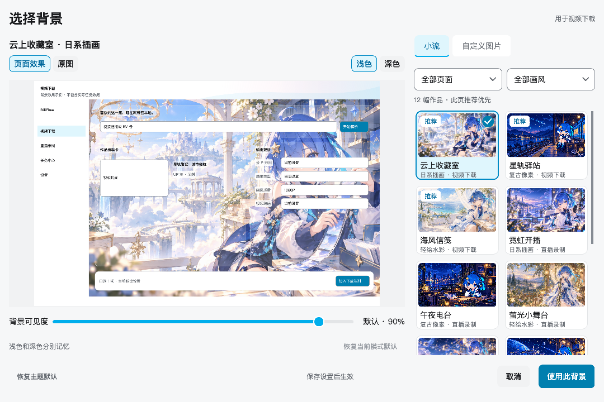
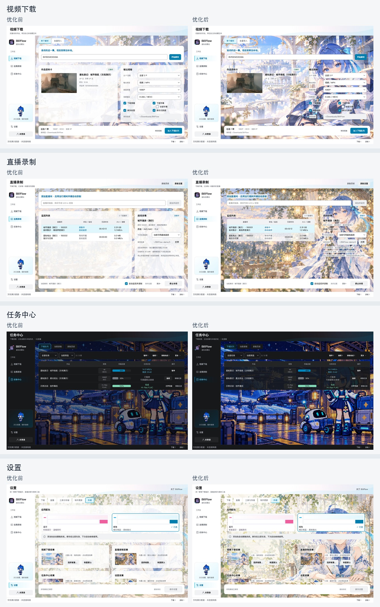

# 背景显示与选图体验

小流与自定义图片现在共用同一种显示方式。自动可见度为浅色 90%、深色 80%，已保存的手动值保持优先；没有图片时使用原有主题外观。

大卡片仅保留约 16% / 20% 不透明度的边框底色。标题、辅助文字、复选框及有效数据行使用局部阅读底色，空表与卡片留白透出图片。阅读底色按主题前景色计算在黑白极端图片上仍满足 4.5:1 对比度的最低不透明度；输入框、表头、菜单、状态标签和固定操作栏保留清晰底色。像素图片始终采用最近邻绘制，没有模糊或动态图像分析。

## 选择背景

- 左侧为大预览，右侧为缩略图库；默认 1080×720，最低 720×520，图库宽度约 288–340px。
- 来源为「小流」「自定义图片」。默认展示全部十二张，当前页面推荐作品排在前面；可以按页面和画风筛选。
- 选中作品显示勾选标记，键盘焦点使用独立虚线。方向键移动焦点，空格或回车选图，Esc 取消。
- 缩略图与「选择背景…」共用一个窗口。支持拖放本地静态图片；读取错误在自定义图片页显示，不清除先前有效选择。
- 「页面效果」使用目标窗口比例的四种只读示例，不包含实际任务数据；「原图」完整展示作品。两种深浅模式分别记忆可见度，预览不改变全局主题。
- 「恢复主题默认」也进入草稿；「使用此背景」确认到设置草稿，仍需「保存设置」生效。取消、撤销、保存失败与重启恢复沿用既有语义。

参考了 [macOS 壁纸设置](https://support.apple.com/en-gb/guide/mac-help/mchlp1103/mac)与 [Windows 背景设置](https://support.microsoft.com/en-us/windows/experience/personalization/change-the-desktop-background-in-windows)的缩略图与图片预览组织方式。文字对比度目标参考 [W3C Contrast Minimum](https://www.w3.org/WAI/WCAG22/Understanding/contrast-minimum.html)。

## 实现与兼容

背景绘制、装饰卡片和局部阅读底色共用主题规则。原图只在选择后解码，图库保留最近两张的有界缓存；滑块、深浅模式和原图切换复用已解码图像。异步结果使用代次校验，取消、恢复默认或重新选图后，旧结果不得覆盖新状态；关闭窗口时定位定时器随窗口销毁。

保持原有 `builtin:<id>`、自定义图片哈希及可见度字段，无配置迁移、新依赖或公共 API。图片与配置只在保存成功后应用，页面和运行中的下载、直播控制器不重建。原始作品、提示词与打包方式保持原样。

## 实际截图



[紧凑窗口](images/backgrounds/native/biliflow-background-gallery-720.png) · [原图模式](images/backgrounds/native/biliflow-background-gallery-original.png) · [自定义图片](images/backgrounds/native/biliflow-background-gallery-custom.png)

[下载页前后对比](images/backgrounds/comparisons/download-before-after.jpg) · [直播页前后对比](images/backgrounds/comparisons/live-before-after.jpg) · [任务页前后对比](images/backgrounds/comparisons/tasks-before-after.jpg) · [设置页前后对比](images/backgrounds/comparisons/settings-before-after.jpg) · [选择窗口前后对比](images/backgrounds/comparisons/gallery-before-after.jpg)



## 验证与复现

相关回归覆盖四个页面、星河与晴海、深浅模式、900×640 / 1120×760 / 1320×860。黑、白及棋盘图片在 100% 可见度下检查真实文字与辅助文字的局部底色；测试图库筛选、键盘、文件拖放、异步过期结果、关闭窗口、草稿隔离、保存失败、重启恢复和冻结资源路径。

```sh
QT_QPA_PLATFORM=offscreen python -m pytest -q tests/test_background_experience.py tests/test_builtin_backgrounds.py tests/test_appearance.py tests/test_workspaces.py tests/test_visual_layout.py tests/test_theme.py tests/test_pixel_mascot.py
QT_QPA_PLATFORM=cocoa python -m pytest -q tests/test_background_experience.py tests/test_builtin_backgrounds.py
python scripts/capture_docs_screenshots.py --builtin-backgrounds-only --output-dir docs/images/backgrounds/offscreen
python scripts/capture_docs_screenshots.py --native --builtin-backgrounds-only --output-dir docs/images/backgrounds/native
python scripts/build_background_comparisons.py
```

2026-10-20：相关回归 195 项通过，Cocoa 原生背景与交互测试 27 项通过。原生截图使用 Qt 6.11.2、72 DPI、Retina 2×。Cocoa 测试进程可留在后台，键盘测试检查窗口保存的焦点目标，不要求抢占用户前台应用。Windows 原生视觉未在本机验收。
