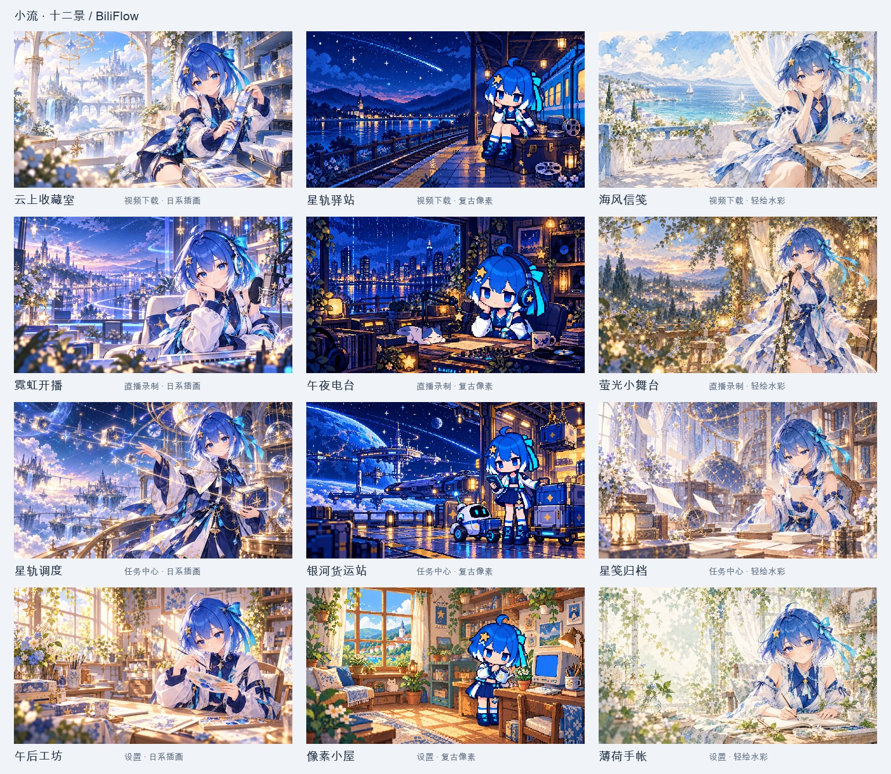

# 小流 · 十二景内置背景



在「设置 → 外观」中找到对应页面的背景卡片，点击「选择背景…」。「小流」图库默认显示全部十二张，当前页面的三张推荐作品优先，也可按页面与画风筛选。每张作品都可用于任意页面。

选择作品或导入本地图片，调节深浅预览及可见度后点击「使用此背景」，再点击设置页「保存设置」应用。取消图库、撤销草稿及恢复默认均沿用原有保存流程；已有背景与首次启动的主题默认外观保留。

## 作品清单

| 作品 | 推荐页面 | 画风 | 生成提示词 |
|---|---|---|---|
| [云上收藏室](../bilibili_downloader/gui/assets/backgrounds/download-anime-cloud.webp) | 视频下载 | 日系插画 | [查看](background-prompts/download-anime-cloud.txt) |
| [星轨驿站](../bilibili_downloader/gui/assets/backgrounds/download-pixel-station.png) | 视频下载 | 复古像素 | [查看](background-prompts/download-pixel-station.txt) |
| [海风信笺](../bilibili_downloader/gui/assets/backgrounds/download-watercolor-sea.webp) | 视频下载 | 轻绘水彩 | [查看](background-prompts/download-watercolor-sea.txt) |
| [霓虹开播](../bilibili_downloader/gui/assets/backgrounds/live-anime-neon.webp) | 直播录制 | 日系插画 | [查看](background-prompts/live-anime-neon.txt) |
| [午夜电台](../bilibili_downloader/gui/assets/backgrounds/live-pixel-radio.png) | 直播录制 | 复古像素 | [查看](background-prompts/live-pixel-radio.txt) |
| [萤光小舞台](../bilibili_downloader/gui/assets/backgrounds/live-watercolor-firefly.webp) | 直播录制 | 轻绘水彩 | [查看](background-prompts/live-watercolor-firefly.txt) |
| [星轨调度](../bilibili_downloader/gui/assets/backgrounds/tasks-anime-orbit.webp) | 任务中心 | 日系插画 | [查看](background-prompts/tasks-anime-orbit.txt) |
| [银河货运站](../bilibili_downloader/gui/assets/backgrounds/tasks-pixel-cargo.png) | 任务中心 | 复古像素 | [查看](background-prompts/tasks-pixel-cargo.txt) |
| [星笺归档](../bilibili_downloader/gui/assets/backgrounds/tasks-watercolor-letters.webp) | 任务中心 | 轻绘水彩 | [查看](background-prompts/tasks-watercolor-letters.txt) |
| [午后工坊](../bilibili_downloader/gui/assets/backgrounds/settings-anime-workshop.webp) | 设置 | 日系插画 | [查看](background-prompts/settings-anime-workshop.txt) |
| [像素小屋](../bilibili_downloader/gui/assets/backgrounds/settings-pixel-cottage.png) | 设置 | 复古像素 | [查看](background-prompts/settings-pixel-cottage.txt) |
| [薄荷手帐](../bilibili_downloader/gui/assets/backgrounds/settings-watercolor-journal.webp) | 设置 | 轻绘水彩 | [查看](background-prompts/settings-watercolor-journal.txt) |

## 角色与构图

保留蓝白发、星形发饰和青色流带，像素作品采用 Q 版，插画与水彩采用舒展的少女比例。下载、直播、任务、设置分别围绕收藏旅途、开播舞台、星轨调度和安静工坊展开。人物主要位于右侧，画面左侧与中部用于界面留白，不包含可读文字、品牌标识或假控件。

「薄荷手帐」最终稿采用右手执笔、左手扶住纸面的自然姿态；修正版已同步到原始稿、运行背景、缩略图与总览。

所有作品使用内置 `image_gen` 逐张生成：以小流原始设定稿固定身份，先生成三种画风代表图，再作为对应风格参照。原始生成 PNG 保存在 [originals/](images/backgrounds/originals)，每张完整提示词见上表；薄荷手帐的提示词另包含最终手臂结构修正。

## 运行资源与兼容

- 日系插画和水彩：2560×1440 WebP；像素背景：640×360 无损 PNG，最近邻显示；缩略图：320×180 PNG。
- 十二张图及缩略图共约 7.93 MiB，安装后完全离线可用。图库仅解码缩略图，原图按当前页面或预览按需读取；原始稿与文档不进入运行资源包。
- 保留原来的背景字符串字段及本地哈希 PNG 引用，增加白名单内的 `builtin:<id>`。内置资源通过源码或冻结程序的资源路径解析，不进入用户背景目录的清理流程。
- 小流和自定义图统一使用浅色 90%、深色 80% 自动可见度，保留已有手动值；大卡片不透明度分别约 16% / 20%。局部文字与数据行按主题计算最小安全阅读底色，输入框、表头及操作栏保留清晰实色。
- 选择窗口采用左侧大预览、右侧图库；「页面效果」以四种页面的只读示例展示效果，「原图」完整展示作品。预览和实际页面共用裁切、遮罩、卡片透明度与像素缩放规则。缺失或损坏的资源回退到主题表面，保留已保存引用。

## 截图与复现

[图库窗口](images/backgrounds/native/biliflow-background-gallery-980.png) · [紧凑图库](images/backgrounds/native/biliflow-background-gallery-720.png) · [下载页](images/backgrounds/native/biliflow-background-download-anime-cloud-light.png) · [直播页](images/backgrounds/native/biliflow-background-live-watercolor-firefly-light.png) · [任务页](images/backgrounds/native/biliflow-background-tasks-pixel-cargo-dark.png) · [设置页](images/backgrounds/native/biliflow-background-settings-watercolor-journal-light.png)

```sh
python scripts/build_background_assets.py
python scripts/capture_docs_screenshots.py --builtin-backgrounds-only --output-dir docs/images/backgrounds/offscreen
python scripts/capture_docs_screenshots.py --native --builtin-backgrounds-only --output-dir docs/images/backgrounds/native
QT_QPA_PLATFORM=offscreen python -m pytest -q tests/test_builtin_backgrounds.py tests/test_appearance.py tests/test_workspaces.py tests/test_visual_layout.py tests/test_theme.py tests/test_pixel_mascot.py
```

离线演示使用临时配置和模拟服务。布局覆盖四页、两套配色、深浅模式及 900×640、1120×760、1320×860；图库覆盖 720×520、720×540、980×660 和 1080×720。原生截图环境为 Qt 6.11.2、Cocoa、72 DPI、Retina 2×，详见[渲染记录](images/backgrounds/native/rendering-profile.json)。

背景显示与选图体验的优化记录、前后对比和最新验证见 [BACKGROUND_EXPERIENCE.md](BACKGROUND_EXPERIENCE.md)。此前图库初版验证：188 项相关回归测试通过，图库的 20 项测试另在原生 Cocoa 后端通过。冻结路径测试覆盖全图和缩略图，wheel 构建验证 24 个运行图片资源随包提供，原始稿和文档不进入 wheel。
