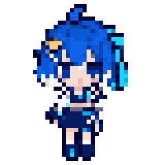

# 小流 · BiliFlow 像素看板娘

小流采用蓝发白色发梢、星形发饰、青色流带与蓝白短外套。角色参考 2233 娘的蓝白二次元气质，以独立的发型、服装和星轨饰品形成 BiliFlow 的形象。



## 素材与运行方式

- 静态首帧：`bilibili_downloader/gui/assets/xiaoliu.png`，40×40 RGBA PNG。
- 待机精灵图：`bilibili_downloader/gui/assets/xiaoliu_idle.png`，240×40，横排六帧；所有帧共用 24 色以内的色板，透明度仅为 0 或 255。
- 显示尺寸：正常 80×80px；侧栏可用高度不足时以 40×40px 角色配两行文案显示；窗口宽度小于 1120px 时收藏卡随侧栏一起收起。
- 动画时序：1600、650、80、120、80、1470ms，共四秒。身体固定，仅眼睛、发梢与飘带变化。卡片隐藏、窗口最小化及应用转入后台时暂停；再次可见时从当前帧继续。
- 绘制采用最近邻缩放。动画不可用时显示独立首帧，素材沿用 `asset_path()` 和现有打包目录。

## 预览与复现

[角色放大图](images/mascot/xiaoliu-preview.png) · [精灵图放大图](images/mascot/xiaoliu-atlas.png) · [动画 GIF](images/mascot/xiaoliu-idle.gif)

离线演示截图覆盖星河、晴海的深浅模式，以及 900×640、1120×640、1120×760、1320×860 四组尺寸。演示使用隔离的临时配置与模拟服务。

- [晴海浅色完整角色](images/mascot/offscreen/biliflow-mascot-bilibili_blue-light-1120x760.png)
- [晴海深色迷你角色](images/mascot/offscreen/biliflow-mascot-bilibili_blue-dark-1120x640.png)
- [星河深色完整角色](images/mascot/offscreen/biliflow-mascot-star_trail-dark-1320x860.png)
- [原生 Retina 浅色完整角色](images/mascot/native/biliflow-mascot-bilibili_blue-light-1120x760.png)
- [原生 Retina 深色迷你角色](images/mascot/native/biliflow-mascot-bilibili_blue-dark-1120x640.png)

2026-10-20 验证：168 项相关测试通过（角色、工作区、布局、主题、外观及冻结资源路径），其中角色的 13 项测试另在原生 Cocoa 后端通过。offscreen 与原生后端各导出 16 张窗口截图、8 张卡片截图；原生环境为 Qt 6.11.2、72 DPI、Retina 2×，见[渲染记录](images/mascot/native/rendering-profile.json)。另检查 1×、1.5×、2× 绘制的像素边缘。

```sh
python scripts/build_mascot_assets.py
python scripts/capture_docs_screenshots.py --mascot-only --output-dir docs/images/mascot/offscreen
python scripts/capture_docs_screenshots.py --native --mascot-only --output-dir docs/images/mascot/native
QT_QPA_PLATFORM=offscreen python -m pytest -q tests/test_pixel_mascot.py tests/test_workspaces.py tests/test_visual_layout.py tests/test_theme.py tests/test_appearance.py
```

构建脚本将选定的原始生成稿按统一裁切框、脚底基线和最近邻采样导出到 40×40 网格；共享身体底帧，只从生成稿提取眼部、发梢和流带区域，避免跨帧抖动。源稿错误镜像的最后一格未用于运行素材。

## 生成记录

生成方式为内置 `image_gen`，请求透明背景；[选定原始生成稿](images/mascot/xiaoliu-imagegen.png) 保留在项目中。以下为所选稿的最终提示词，输入图为同一角色的初稿：

```text
Edit target: the supplied Xiao Liu sprite sheet. Keep her recognizable blue bob, white tips, small star hairclip, cyan side ribbon, blue-white jacket and navy skirt. REDRAW and EXTREMELY SIMPLIFY this into authentic tiny 1990s handheld-game PIXEL ART. The current drawing has far too much detail and soft shading. Each character must use ONLY A 40x40 PIXEL GRID, with visibly LARGE square pixel clusters when enlarged. One eye is only 2 by 3 logical pixels, a hand only 2 by 2, face about 12 pixels wide. Use no more than 20 entirely flat solid colors across the whole sprite sheet, fully opaque pixels or fully transparent pixels ONLY. No antialiasing, no fine lines, no smooth curves, no tiny texture, no gradients, no realistic shading. 2-head chibi proportions. Output a WIDE SHORT single strip of EXACTLY SIX EQUAL SQUARE CELLS in a 6:1 aspect ratio, total logical resolution 240x40, enlarged as nearest-neighbor pixels. The head, face, star clip on image LEFT, side ribbon on image RIGHT, body and feet must be at identical coordinates in ALL SIX FRAMES. Do NOT mirror any frame (the current last frame is wrong). Frame 0 eyes open ribbon centered; frame 1 eyes open ribbon 1 pixel right; frame 2 eyes half closed ribbon right; frame 3 eyes closed smiling ribbon right; frame 4 eyes open ribbon centered identical to frame 0; frame 5 eyes open ribbon 1 pixel left. Body completely still. Six characters must be the exact same size and all fully fit inside their own square cell with 2 logical pixels transparent margin. True transparent background. No shadows or floor or labels or grid lines or checkerboard. Crisp low-resolution professionally designed game sprite, NOT a high-resolution anime illustration.
```

运行素材经过网格与色板导出，以实际 PNG 为准；原始生成稿的画布尺寸和颜色数量不直接作为运行约定。
