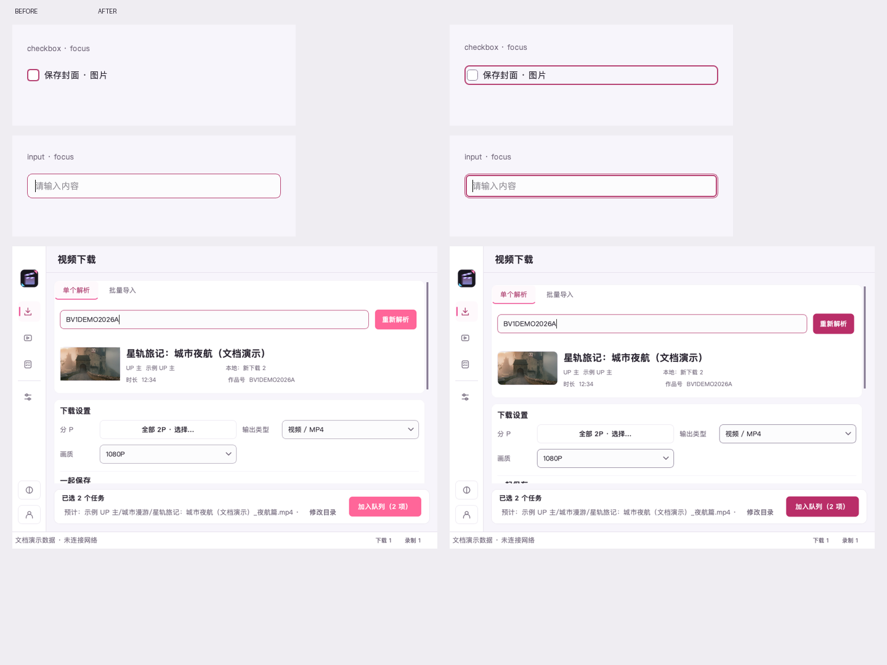

# 全界面细节精修

2026-11-10 完成界面精修，已随 `v0.8.11b2` 发布。在第二轮收藏工作台布局上继续精修 Qt 控件与弹窗；保留共享下载配置、星河／晴海、小流、背景和温暖短句，不新增前端运行依赖。发布流水线与公开附件复核见[发布检查](BUILDING.md)。

[代表页面、组件状态与全部弹窗索引](images/ui-detail/index.html) · [逐实例清单](images/ui-detail/instance-summary.json) · [结构化验证记录](images/ui-detail/validation.json)

## 本轮实际修改

| 对象 | 处理结果 |
| --- | --- |
| 输入框、文本区 | 统一普通、悬停、禁用、只读及错误描边；独立绘制键盘焦点。中文输入法提交、撤销和复制粘贴保留原生语义。只读菜单保留选择与复制，修改动作禁用；密码字段禁止复制和剪切。清除按钮补充中文名称。 |
| 下拉框、菜单 | 统一单箭头、选项勾选、圆角与键盘焦点；修复弹出时原生箭头和自绘箭头叠画。保留长选项省略、禁用项跳过、上／下展开及 Esc 取消。未聚焦时滚轮交给页面；聚焦后遵循当前 Qt 平台样式。 |
| 复选框、附件、表格 | 普通复选框、附件选择卡和表格勾选共用 18px 指示器、4px 圆角和 1.8px 勾线。保留半选与当前行的区别；修复标签与指示器重叠。 |
| 数字框、滑块 | 保留边界、键盘和拖动语义，增减按钮使用字段名称构成无障碍名称；字体增大时随内容增高，未聚焦滚轮不意外改值。 |
| 按钮、页签、导航 | 主按钮、普通按钮、溢出菜单、表格当前行使用同一 2px 焦点规范。取消重复的原生／自绘焦点边框，选中态与焦点可同时辨认；溢出操作继续映射原动作。 |
| 列表、表头 | 补齐任务、批量、直播间、文件和记录表的无障碍名称，保留搜索、跨筛选选择和当前行区别。用长标题、长路径、大数量和失败提示展开检查。 |
| 封面、背景与主题卡 | 封面和缩略图按真实 DPR 裁剪圆角，避免方角和失真；主题卡、背景卡根据字体计算文字行距和高度，移除重复虚线焦点。 |
| 弹窗、固定操作区 | 统一外壳、屏幕边界、默认按钮与焦点返回。直播间设置、来源解析详情接入共享工作流弹窗；关闭、更新操作支持小屏排列；长消息提供可滚动正文。设置底栏修正为 64px 基准，消除按钮底部 2px 裁切；消息框按钮区跟随字体增高。 |
| 错误定位 | 错误说明与真实字段关联。高级区自动展开后持续等待布局稳定，再滚动到完整字段与说明；用户继续操作会结束定位，不抢回焦点。 |
| 二维码 | 保留 220px 外框及安静区，按实际内容区域和 DPR 绘制；放大字体时登录正文可滚动，关闭操作仍可达。 |

下载欢迎仍为「喜欢的这一集，留在身边。」；队列空状态为「收藏，从这里开始。」；直播空状态为「等待下一场星光」「留住每一场相遇」。媒体确认保存成功才显示「已存好，留着慢慢看。」；部分完成、附件缺失、回退、文件影响和操作范围保持明确。

## 共用规范与例外

尺寸集中在 `UI_METRICS`：常规 40px、主操作 44px、紧凑操作 32px；控件圆角 8px、容器 12px、内部元素 4px。字体放大允许控件增高。设置操作栏的 64px 包含按钮、上下 8px 留白和边框，不能套用输入控件的高度。

普通描边 1px，键盘焦点 2px，通过透明子层或共享绘制实现，不参与布局。错误边框与焦点独立存在。主按钮以白色内焦点环保持可辨认；其他控件读取主题焦点色。Windows 标题按钮保留已有独立 DPR 绘制，避免重复叠加焦点。鼠标和键盘状态分别处理，切换不改变外部尺寸。

两套配色的普通正文、辅助文字和主按钮文字通过 4.5:1 检查，输入边界与焦点通过 3:1 检查。星河主色沿同一玫瑰色相调整明度，解决白字在普通／悬停／按下时对比不足；晴海保持品牌蓝。禁用内容不作为普通正文对比目标。图片背景继续共用阅读保护，实际背景截图另列。

现有状态过渡 120ms、展开 160ms 保留；焦点和错误提示立即反馈。焦点层隐藏后无独立动画或计时器。二维码采用最近邻缩放，作品与背景保留平滑缩放。

以下内容保留其原生语义，并在所属组件检查，避免另造一套交互：

- Qt 内部编辑器、滚动视口、表头和文件浏览树按父组件合并记录；虚拟化表格项通过真实绘制与交互回归检查，不为每一行复制 QWidget。
- macOS 系统菜单、系统窗口装饰与红黄绿按钮由系统管理，QWidget 截图不包含系统合成结果。
- 文件选择器沿用平台策略：macOS 使用异步 Qt 文件窗口；Windows 保留原生窗口。演示图册的文件窗口使用 Qt 内容用于跨尺寸检查，不能作为 Windows 原生验证。
- Cocoa 的 `SH_ComboBox_AllowWheelScrolling` 为 false；聚焦后的下拉框仍遵循该平台策略，键盘选择正常。未聚焦滚轮保护跨平台生效。
- 文本浏览器保留 Qt 链接交互；普通编辑器与只读路径使用共享中文右键菜单。技术诊断、第三方更新说明没有删减。

## 完整清单与图册

完整生成物位于 `build/ui-detail/review/index.html`，每后端 2381 张截图，含 483 组真实前后对照，可以离线按类别、配色、深浅、字体和关键字筛选，切换「本轮」「前后对照」「macOS 原生」。文档中的图册保留代表页和全部 50 类独立弹窗／消息状态；完整矩阵由脚本复现。

清单由实际运行的控件树生成，包含 2618 条交互控件路径，每条记录类型、标签、适用规则、可见性、禁用状态、焦点策略、尺寸、裁切及截图位置。正文标签、封面、卡片和边角在所属页面或弹窗的整图中复核，不单独计入交互控件数量。完整逐状态数据以 gzip 保存，摘要提供可搜索清单。

弹窗矩阵含 30 个专有页面／表单状态与 20 个消息调用入口，每种在四套配色模式、三种尺寸和小屏 125%／150% 字体下展开，共 1000 例。消息入口通过源码扫描建立索引，保留来源文件、行号和函数；动态参数明确使用离线示例。它验证外壳和文字布局，不等同于执行每个业务条件。已有业务回归另外验证真实入口、取消、保存失败、撤销、草稿及文件保留规则。

前后对照来自本轮修改前保留的实际截图，采用相同演示数据、配色、尺寸及 offscreen 后端。Cocoa 单独展示，避免把 DPI 差异当成视觉改动。



## 实际验证结果

| 检查 | 结果 |
| --- | --- |
| 完整 offscreen 测试 | 1383 通过，6 跳过，457.06 秒；9 条既有测试激活窗口的 Qt 弃用提示 |
| macOS Cocoa 专项 | 323 通过，203.57 秒；4 条同类弃用提示 |
| 新增控件回归 | 16 项，含四主题对比度、只读／密码菜单、中文输入、滚轮、错误与焦点、半选、真实绘制、DPR 裁剪、菜单键盘操作 |
| 组件状态矩阵 | 每后端 816 张：12 类组件、四主题、100%／125%／150% 字体；状态间外部尺寸一致；另有 12 张菜单／下拉浮层 |
| 页面与弹窗矩阵 | 每后端 1538 个记录状态；含 1000 例独立弹窗／消息、144 例四工作区无图／内置／自定义背景，40 例小屏 125%／150% 字体工作区，以及空态、解析后、音频、批量、错误、长内容、草稿和任务筛选 |
| 几何检查 | 滚动区外的可见交互控件裁切为 0；滚动区内的部分可见项保留原始标记。工作区 12 例、长内容 60 例与放大字体 40 例无横向溢出，尺寸符合请求 |
| 共享配置与交互 | 视频／音频切换、单个／批量入队、隐藏高级字段定位、跨筛选选择、设置草稿、焦点返回及异步文件选择回归通过 |
| 静态检查 | Ruff、compileall、`git diff --check` 通过 |

原生验证使用 macOS 27.0.1（26A434）、Qt 6.11.2、PingFang SC，72 逻辑 DPI、Retina 2×。offscreen 为 96 DPI、1×。浮层合成截图统一保存逻辑像素，其余原生截图保留物理像素；渲染信息随图册保存。测试通过 Qt 激活受测窗口，不更改系统键盘访问偏好。

本地精修阶段没有 Windows 桌面环境。后续 beta 2 发布 CI 已在 Windows 托管桌面完成原生交互、四档缩放与截图，CI 17 项和发布流水线 5 项全部通过；平台结果见[发布验证记录](validation/releases/0.8.11b2/ci-test-results.json)。用户 Windows 设备的人工操作、混合 DPI 及真实输入法仍需单独验证；本机没有覆盖安装。

## 复现与兼容边界

```bash
QT_QPA_PLATFORM=offscreen .venv/bin/python -m pytest -q
QT_QPA_PLATFORM=cocoa .venv/bin/python -m pytest -q tests/test_control_details.py tests/test_combo_box.py tests/test_workspaces.py tests/test_dialog_placement.py tests/test_ui_feedback.py tests/test_ui_polish.py tests/test_warm_workspaces.py tests/test_theme.py tests/test_release_notes.py tests/test_file_picker.py tests/test_builtin_backgrounds.py tests/test_background_experience.py tests/test_update_gui.py
.venv/bin/ruff check bilibili_downloader tests packaging_hooks scripts
.venv/bin/python -m compileall -q bilibili_downloader tests scripts
git diff --check
.venv/bin/python -m scripts.capture_docs_screenshots --detail-audit-only --output-dir build/ui-detail/delivery/offscreen
.venv/bin/python -m scripts.capture_docs_screenshots --detail-audit-only --native --physical-pixels --output-dir build/ui-detail/delivery/native
.venv/bin/python -m scripts.build_detail_review
```

原生截图需要 macOS 桌面会话与 WindowServer。截图在临时配置、任务库、媒体、二维码和 Qt 设置下运行，显式禁用自动检查更新，不读取真实登录或下载记录。前后对照需要预先保留修改前的截图；没有旧截图时只生成本轮和原生图册。

原始日志保存于 `build/ui-detail/pytest-delivery.log`、`pytest-native-delivery.log`、`capture-delivery.log` 和 `capture-native-delivery.log`。所有产品改动限于 GUI；没有增加持久化配置字段，没有改公共业务 API、任务数据格式或下载／录制规则。
