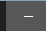
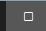
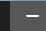
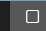

# 按钮、文本选区与 Windows 标题栏复核

日期：2026-10-22。分支：`codex/fluent-design-polish`。

## 实现

- 星河主题的主要按钮改为 B 站官网粉色阶搭配白字。日间默认／悬停／按下为 `#FF6699`／`#FF8CB0`／`#E84B85`；夜间为官网深色阶 `#D44E7D`／`#DC6D94`／`#A73E65`。青蓝按钮保留原配色。
- 输入框选区改用独立参数，不再复用导航与表格的弱选中底色。单行输入、富文本和纯文本编辑框在有焦点／无焦点的程序选区中均检查实际绘制像素；活动、非活动及禁用调色板共享清晰的选区文字颜色。
- Windows 保留 Qt 扩展标题栏、原有窗口操作、系统菜单及 Snap 命中逻辑。将 Qt 的原生标题栏图层裁剪到三个窗口按钮，启用不透明中性材质，避免透明白色悬停层的合成错误；Snap 悬停进入／离开时补一次重绘，避免最大化按钮停留在旧画面。
- 标题栏裁剪区域按尺寸、DPI 和原生句柄缓存。没有新增轮询或持续动画刷新；窗口切换、调整尺寸及主题变化后更新材质与区域。

来源：[B 站官网 CSS](https://s1.hdslb.com/bfs/static/shanks/laputa-home/assets/index-3f345f9f.css)、[Qt 6.11.1 标题栏绘制](https://github.com/qt/qtbase/blob/v6.11.1/src/plugins/platforms/windows/qwindowswindow.cpp)、[Qt 位图转换](https://github.com/qt/qtbase/blob/v6.11.1/src/gui/image/qpixmap_win.cpp)。具体视觉规则见 [Fluent 规范](FLUENT_DESIGN.md)。

## 对比度

| 主题 | 选区底色／文字 | 文字与选区 | 选区与输入框 |
|---|---|---|---|
| 星河日间 | `#AD1C5B`／白 | 6.79:1 | 6.36:1 |
| 星河夜间 | `#A73E65`／白 | 5.97:1 | 2.62:1 |
| 晴海日间 | `#007FAF`／白 | 4.51:1 | 4.29:1 |
| 晴海夜间 | `#007FAF`／白 | 4.51:1 | 3.74:1 |

粉底白字按用户确认采用官方品牌搭配，粉色主要按钮不计入普通正文 4.5:1 的保证。普通正文、文本选区与青蓝主要按钮仍保留对应对比度检查。Windows 夜间悬停的实际底色为 `#575757`，浅色图标与背景约为 7:1。

## 验证

本地环境为 macOS、Python 3.11.15、Qt 6.11.2：

- 完整离屏 pytest：**1005 通过、6 项平台相关跳过**。
- 原生 Cocoa 专项：**71 通过、5 项 Windows 专项跳过**。
- Ruff、源码编译及 diff 检查通过。
- 使用隔离的离线演示数据更新主要文档截图。另生成两套配色的原生 UI 专项截图与星河完整页面、弹窗矩阵。

Windows 使用 GitHub Actions 的 Windows 原生桌面、Python 3.12、固定依赖 Qt 6.11.1。桌面截图包含 Qt 单独的分层标题栏；QWidget 抓图不能验证该图层。

[最终 CI 运行](https://github.com/itsVicOC/bilibili-downloader/actions/runs/39795653810) 对应代码提交 `d5661e2`。原生验证覆盖两套配色 × 深浅模式 × 普通／最大化／还原 × 最小化／最大化悬停，同时检查真实 Win32 点击、激活、窗口状态、还原几何和重新显示；Qt 缩放分别为 100% 与 150%。原生检查与截图步骤已通过，包含 48 张悬停像素截图；完整 Windows 原生证据共 915 张图片。

- Windows 100% 原生专项：**40 通过**。
- Windows 150% 原生标题栏专项：**17 通过**。
- Windows 3.12 完整离屏 pytest：**996 通过、15 跳过**。跳过项为九项需 FFmpeg 的录制导出场景及六项原生平台场景；Windows 原生标题栏场景已在上面的独立桌面步骤执行。
- Windows 编译及 Ruff 通过；macOS 原生矩阵、完整回归、编译及 Ruff 通过。Linux 3.11／3.12 回归、两平台更新器、三平台录制器和依赖审计通过。

该轮 CI **11 项任务全部成功**。后续验收归档提交仅更新文档和截图，测试对应的应用及测试代码保持在上述提交。

以下为 Windows 原生夜间悬停截图的放大展示：

| Qt 缩放 | 最小化悬停 | 最大化悬停 |
|---|---|---|
| 100% |  |  |
| 150% |  |  |

Windows 夜间文本选区实绘：[星河](images/readability/windows-star_trail-selection-dark.png) · [晴海](images/readability/windows-bilibili_blue-selection-dark.png)。

150% 是 Qt 应用缩放检查，不代表混合 DPI 多显示器的硬件实测。后者仍未验收。Snap 命中与窗口按钮交互有回归检查，未将其计作 Windows 11 Snap 浮层的人工验收。

本地截图入口为 `build/fluent-design/followup/index.html`，完整 pytest 日志为同目录 `pytest-final.log`。Windows 原生证据在 CI 的 `ui-parity-Windows` 附件中；附件保留七天，本次已下载到 `build/fluent-design/followup/windows-verified/`，该目录的 `index.html` 可查看完整矩阵。关键截图另存于 `docs/images/readability/` 随分支归档。
