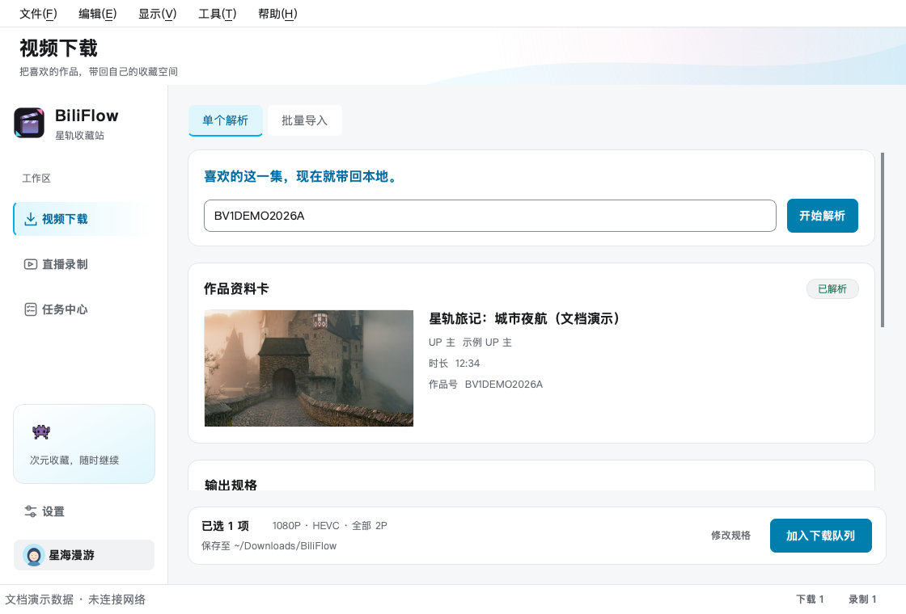
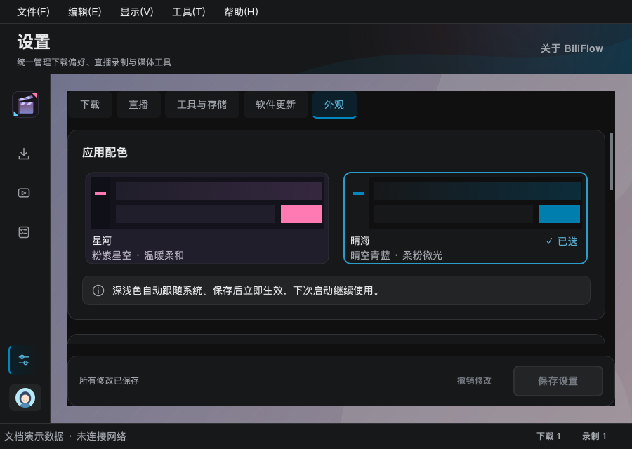
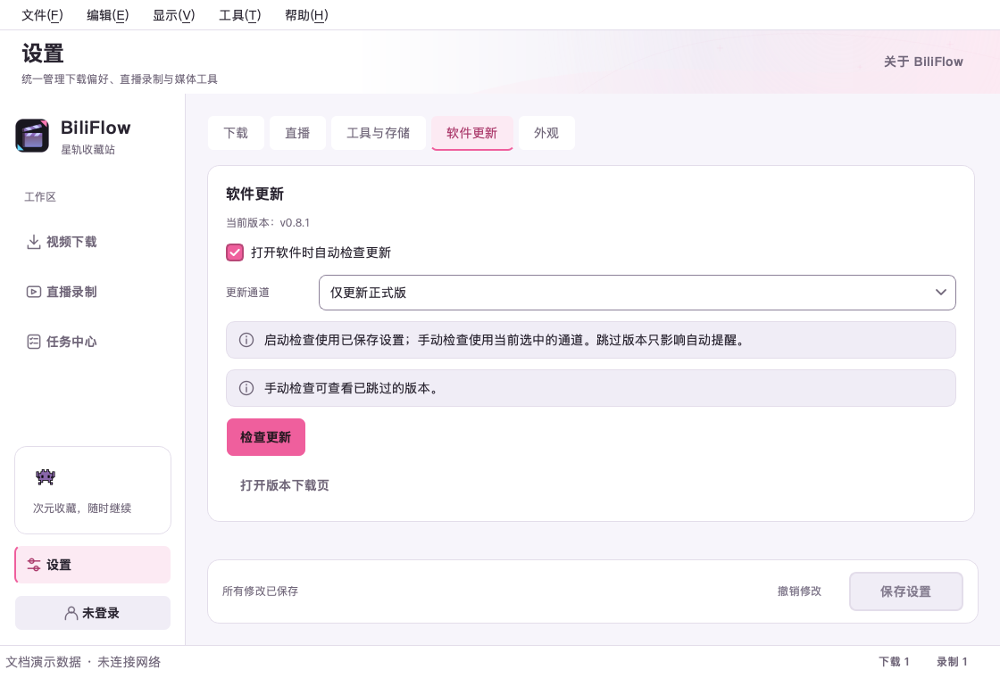

# 用户指南

本文对应 `v0.8.2`。从 `v0.8.1` 升级会保留已有配置和任务，外观默认继续使用粉紫「星河」。本版新增的背景及可见度选择需要在「设置 → 外观」保存后生效。

直播功能的使用方法、full/lite 引擎配置与验收边界见[直播录制](LIVE_RECORDING.md)。直播入口独立于点播任务，房间号请在「直播录制」页输入。

## 支持范围

BiliFlow 支持单个/多 P 视频、UP 主合集与系列、收藏夹、BV/AV 号，以及中国大陆主站的番剧 `ep` 单集、`ss` 季度和 `md` 媒体页。指向这些页面的 b23.tv 短链也受支持。合集、收藏夹和番剧季度使用“批量导入”入口，解析后可以筛选作品并自动跳过相同规格的已有任务。

番剧整季会先列出正片，再按接口顺序列出特别篇、PV、花絮等附加章节。正片默认勾选，附加章节默认不勾选。支持无需登录即可完整播放的剧集，以及当前账号已经获得完整播放权限的免费、大会员或已购内容。

点播解析不接受直播链接，请使用独立的「直播录制」工作台。国际站、课程、稍后再看、动态、DRM、地区代理解析以及任何付费、会员或账号权限绕过均不受支持。接口只返回试看、地区受限、无完整播放权或无可用未加密流时，任务会在创建媒体临时文件前停止。

可用画质取决于视频本身、账号权限和 Bilibili 返回的流。未登录时通常无法获得会员画质；选择的编码不可用时，应用会回退到实际可用的流。

画质、视频编码或音频规格发生回退时，任务仍会完成，并在任务行和元数据中记录实际规格。字幕、弹幕、封面或元数据等附加项失败不会删除已经成功封装的媒体文件，任务会显示为“部分完成”，可在任务提示中查看具体警告。

## 界面速览

顶部共享工具栏显示当前工作区标题与页头操作。macOS 工具栏融合系统标题栏，设置、关于和退出位于系统应用菜单；Windows 使用原生窗口边框与对应菜单。两端页面和操作一致。

快捷键：Cmd/Ctrl+L 返回单个解析并聚焦来源输入；Cmd/Ctrl+1、2、3、4 分别进入下载、直播、任务和设置。设置快捷键为 Cmd+,（macOS）或 Ctrl+,（Windows）。多行批量输入中的 Enter 仍用于换行，菜单或弹窗中的 Esc 用于取消。

侧边栏提供「视频下载」「直播录制」「任务中心」，底部是统一设置与账号入口。窗口宽度低于 1120px 时，侧栏收为图标栏；悬停可查看入口名称。页面切换保留输入、解析结果、筛选和选择，下载与录制持续运行。底部活动数量可直接跳转到下载队列或当前录制。

视频下载提供「单个解析」「批量导入」两个页签，任务中心提供「下载队列」「当前录制」「录制历史」。加入下载队列后保留当前页，便于连续添加；成功提示中的「查看任务」可进入任务中心。下图均为离线演示数据。


完整深浅主题、三种窗口尺寸和关键状态截图见[视觉规范与验证](UI_DESIGN.md)。

## GUI 工作流

### 解析与下载

1. 在「视频下载 → 单个解析」输入框粘贴 BV/AV/ep 号、完整视频/番剧单集链接或 b23.tv 短链。`ss/md` 请使用批量导入。
2. 点击“开始解析”，等待作品资料卡和可用规格更新。
3. 多 P 视频可选择某一分 P 或全部分 P，再选择画质与编码。需要时勾选“下载弹幕”或“下载字幕”。
4. 点击“加入下载队列”，查看新增数量和重复项提示。当前解析结果与规格会保留；修改来源后需重新解析才能加入。
5. 在「任务中心 → 下载队列」查看进度、速度、预计剩余时间和状态。选中任务可读取完整错误、警告与保存路径。运行中任务可以暂停并保留断点；暂停和失败任务可以继续或重试。完成后可打开文件目录或只清除任务记录。

未解析时，页面显示简洁的链接引导；解析成功后展开资料与规格。底部始终显示本次画质、编码、分 P 和保存位置摘要，「修改规格」会定位到输出表单。收藏夹、合集、番剧季度或直播链接放错入口时，可通过提示中的按钮切换，并带入原链接；短链的类型在后台展开后识别。

单个解析与批量导入共用同样的固定底部操作卡：左侧显示状态、媒体规格和保存位置，右侧依次为「修改规格」「加入下载队列」。解析前也可预选规格，解析后保留可用的画质、编码与附加项选择；所选画质或编码不可用时自动切换到可用项。单个结果尚未解析、来源已修改或批量未勾选作品时，「加入下载队列」禁用。模式切换使用顶部页签。

底栏演示：[单个解析](images/native/output/biliflow-output-single-bar-light.png) · [批量导入](images/native/output/biliflow-output-batch-bar-light.png)。

直播与设置也使用同样的固定操作卡，主操作位于右侧，房间信息和保存状态保留在左侧。页签与任务筛选工具栏具有独立底色，背景可见度较高时仍能清楚阅读；Tab 键移动到按钮时显示焦点边框。

| 界面状态 | 含义 | 可执行操作 |
|---|---|---|
| 等待中 | 任务已保存，等待并发槽位 | 暂停 |
| 下载中 | 正在传输视频、音频或附加项 | 暂停并保留断点 |
| 已暂停 | 网络传输和 FFmpeg 已停止 | 继续、移除记录 |
| 合并中 | FFmpeg 正在无损封装媒体流 | 暂停会终止合并，继续后重新处理 |
| 完成 | 主媒体和所选附加项均完成 | 打开目录、移除记录 |
| 部分完成 | 主媒体成功，但一个或多个附加项失败 | 查看任务提示中的警告 |
| 失败 | 任务停止并保留可复用的断点 | 查看错误、修复原因后继续 |

批量导入接受每行一个视频、番剧 `ep/ss/md`、合集、系列或收藏夹来源。点击“解析并预览”后可以全选、取消全选或逐项筛选；番剧来源列会显示“系列 · 季度 · 章节”。已有同源作品会被标注，最终按视频分 P 或番剧剧集、媒体规格、输出相对路径和归档附加项精确去重。番剧整季中的单集失败不会中止其他任务。

批量导入位于视频下载工作台的第二个页签。解析成功后，来源自动收为一行摘要，为作品清单留出空间；点击「编辑来源」可展开修改，也可直接「重新解析」。作品清单支持「全选」「清空选择」和逐项勾选，同一来源不再重复显示来源列。

底部固定操作卡集中显示已选数量、媒体规格与保存位置；点击「修改规格」可返回共用输出表单。来源文本变化后，旧预览会标记失效，重新解析前无法加入队列；部分解析失败时，统计和「查看未解析项」入口位于清单底部，成功作品仍可继续加入。全部来源失败时显示独立提示和详情入口。

批量解析显示当前来源、分页或作品读取阶段及数量；总量未知时显示不定进度。点击「取消解析」后，会在当前网络请求结束时停止继续请求，已解析作品与失败记录仍保留。批量输出摘要显示共享媒体规格与保存目录，每个所选作品会导入全部分 P。

结果分别统计成功作品、跳过作品、失败来源和重复项；收藏夹中部分视频失效不等于整个收藏夹失败。「查看详情」列出具体内容、原因与重试链接，可以复制失败链接或仅重试失败项。重试会合并成功结果，并保留已有作品的勾选状态；修改来源使预览失效后，需要先重新解析。缺少作品编号的条目通过原来源重试。


第一次真正加入下载任务时，GUI 会显示版本化版权确认。取消不会创建任务或临时媒体文件；提示内容发生实质变化后会再次要求确认。详见[版权与合规说明](COPYRIGHT.md)。

下载队列顶部可按进行中、已暂停、已完成或需要处理筛选。批量操作范围默认「当前筛选」，也可以选择「所有任务」；暂停、继续、移除完成按钮显示受影响数量。暂停停止网络传输和 FFmpeg 并保留断点；继续会处理范围内已暂停、失败或已取消的任务，重新获取有效流地址后续传。

「移除记录」「移除完成」只删除历史记录，不删除媒体文件或断点。本次运行可点击提示中的「撤销」恢复最近一次移除，包括状态、进度、警告与保存位置；已经创建相同任务时不会重复恢复。「打开目录」直接打开任务的保存目录。规格用紧凑标签展示，选中任务可查看完整内容。

「更多 → 清理下载缓存」会删除所有未完成断点，必须先暂停全部任务；统一设置的「工具与存储」也提供此入口。


### 登录

登录不是普通公开视频下载的必要条件。需要会员画质或账号专属内容时，可打开“登录 B 站账号”，默认展示扫码登录，Cookie 输入保留为备用方式：

- 手动登录可以填写单个 `SESSDATA` 值或完整 Cookie 字符串；解析后只保留安全策略中列出的白名单字段，并要求存在 `SESSDATA`。
- 扫码登录依赖 Bilibili 当前接口，接口变化时可能暂时不可用。
- 登录凭据以 `auth-cookie-bundle-v1` 保存到系统凭据库，不会上传到项目维护者服务器，也不会发送给媒体 CDN。
- 凭据库不可用时，登录只在当前运行有效，Cookie 不会写入配置文件；重启后需要重新登录。
- 登录页显示账号名和会员状态，不显示 Cookie 内容。账号观看权限不等于复制、传播或商业使用授权。

登录后，侧栏左下角显示用户名与圆形头像，点击可管理登录或退出。窄窗口只显示头像，悬停可查看完整用户名、会员状态和 UID。头像在后台加载；加载失败时保留默认账号图标与用户名，不影响登录和下载。退出登录后清除显示的账号信息。

已登录时，账号入口先展示当前身份和退出操作，点击「切换账号」才展开登录方式；不会默认要求重新填写 Cookie。

不要把 SESSDATA 发送给他人，也不要粘贴到 Issue、日志或截图中。退出登录可在登录窗口清除凭据。


### 统一设置

侧栏底部「设置」包含「下载」「直播」「工具与存储」「软件更新」「外观」五个页签。修改只保存在当前草稿中，点击底部「保存设置」后才会生效；「撤销修改」恢复已保存值。未保存离开时可选择保存、放弃或继续编辑。错误会显示在对应字段下方。

设置页右上角「关于 BiliFlow」可查看当前版本与功能说明。

「下载」页签包含以下选项：

- **输出目录**：默认是 `~/Downloads/bilibili`。
- **默认画质**：新解析任务的初始画质。
- **默认输出**：视频 MP4 或仅音频；普通音轨封装为 M4A，Hi-Res FLAC 保持 `.flac`。
- **默认音频**：AAC 64/192kbps、Dolby Atmos 或 Hi-Res FLAC；是否可用取决于视频和账号权限。
- **目录模板**：控制输出目录和文件名，支持 `title`、`author`、`bvid`、`page`、`part`、`part_suffix`、`collection`、`quality`、`codec` 字段。
- **番剧目录模板**：独立控制番剧输出，支持 `series`、`season`、`section`、`episode`、`episode_number`。默认 `{series}/{season}/{section}/{episode_number} - {episode}`；缺失季度或章节时使用“本季”和“正片”，章节内集号为两位。
- **最大并发**：范围 1–8。网络或磁盘较慢时建议 1–3。
- **归档附加项**：控制弹幕、首选/全部字幕、封面和 JSON 元数据的默认状态。

例如 `{author}/{collection}/{title}{part_suffix}` 会按 UP 主和合集建立目录。标题等远端字段会逐段清理，不能通过模板写到输出目录之外。没有合集名称时，对应字段会使用 `untitled`，不需要合集目录时可从模板中移除 `{collection}`。

「直播」页签管理默认保存目录、并发录制、分段时长和保留空间。目录与分段默认值仅影响新添加的房间；已有房间请使用直播工作台中的「房间设置」。单房间画质在下次拉流时生效。

「工具与存储」页签管理 FFmpeg 与配套录制引擎路径，并提供检测与下载缓存清理。FFmpeg 自定义路径优先级最高；留空时 full 包使用内置版本，lite 包和源码运行从系统 PATH 与常见安装位置查找。路径检查在后台运行，检查期间修改路径后需要重新检查。

### 主题与工作区背景

在「设置 → 外观」通过两张预览卡选择「星河」或「晴海」。「星河」沿用粉紫星空；「晴海」以青蓝为强调色，在白色 / 炭灰表面上加入天空渐变、柔粉微光与轻盈波纹。两套配色均实时跟随系统日间/夜间设置。首次使用和旧配置默认保留「星河」，已有主题选择会随名称更新自动保留。点击「保存设置」后应用，无需重启，下次启动继续使用。

已选主题显示实线边框和「✓ 已选」。键盘焦点使用独立虚线外圈，Tab 移动焦点不会更改选择，按空格选择主题。

主题渐变与星轨／波纹集中在顶部工作区横幅；链接输入卡使用纯色底面，让来源操作与背景装饰层次清晰。

下载、直播、任务、设置四个工作区可以分别选择本地背景。下载中的单个解析与批量导入共用一张图，任务和设置的各页签也共用所属工作区背景。选图后先显示缩略预览，保存后才改变实际页面；「恢复默认」同样需要保存，「撤销修改」会放弃尚未保存的选图。

宽窗口中四区背景并排显示。点击背景缩略图，可查看当前主题草稿下的居中裁切、遮罩与内容卡片效果。在预览窗口拖动「背景可见度」，向右更清晰：0% 隐藏图片，100% 显示原图。浅色和深色分别记忆，每个工作区独立设置；「恢复当前模式默认」恢复主题原有遮罩。

预览实时显示调节效果。「使用此效果」保留本次调节，再点击设置页「保存设置」才应用到实际页面并记忆；取消或关闭预览不保留本次调节。「撤销修改」可恢复已保存值，保存失败时保留草稿和原外观。

支持静态 PNG、JPEG、WebP，原文件不超过 20 MiB、解码尺寸不超过 4000 万像素。图片会处理拍摄方向、等比缩至最长边 3840 像素，并保存不含原始元数据的应用内副本。原图移动或删除不影响已保存背景。

背景固定在主内容区域，居中等比填满并裁切，自动叠加与深浅主题匹配的遮罩。侧栏、顶部工具栏以及卡片、输入框、表格保留主题底色。图片丢失或损坏时恢复默认显示，外观设置中会提示重新选图。





### 检查和安装更新

「软件更新」默认开启启动检查，默认通道为「仅更新正式版」；「更新最新版」包含 beta、rc 等预发布版。启动检查使用已保存设置，每次启动后台检查一次；「检查更新」使用当前选中的通道，不会保存其他草稿。自动检查失败不会弹窗，手动检查会显示结果或失败原因。

发现新版本时可以选择：

- **立即更新**：下载并验证 SHA-256，保持当前平台、架构和 full/lite 类型，安装后重启。
- **下次更新**：本次不安装，下次启动再次提醒。
- **跳过此版本**：只关闭这个版本的自动提醒，手动检查仍可查看和安装。

如果下载、录制或导出正在运行，更新包准备好后会再次确认。选择「停止任务并重启」会暂停下载并保留断点、完成录制收尾并保留文件、取消导出；选择「稍后重启」会保留下载包，可以在设置页点击「安装并重启」。普通退出不会安装更新。

自动安装支持官方 macOS、Windows 包。源码运行、Linux、缺少匹配包或安装目录不可写时，请使用「版本下载页」手动安装；已经下载的包可以通过「打开已下载更新包」打开。软件不申请管理员权限、不自动降级、不切换 full/lite。

更新程序会等待其他实例退出，保留旧程序及配置、任务数据库备份。新版启动确认失败时恢复旧版和数据，并在重新打开后说明原因。首次使用此功能需要先手动安装一个已包含更新功能的版本。

支持自定义背景的版本也会备份、恢复应用数据目录中的 `backgrounds/`，使背景副本与配置保持一致。手动备份或迁移配置时，请同时复制该目录。




## CLI

查看命令：

```bash
python -m bilibili_downloader --help
python -m bilibili_downloader download --help
```

只解析视频信息：

```bash
python -m bilibili_downloader test BV1GJ411x7h7
python -m bilibili_downloader test av170001
python -m bilibili_downloader test "https://b23.tv/example"
python -m bilibili_downloader test ep123
```

下载：

```bash
python -m bilibili_downloader download BV1GJ411x7h7 \
  --quality 80 \
  --output ./downloads \
  --danmaku \
  --subtitle
```

番剧示例：

```bash
# 单集
python -m bilibili_downloader download ep123 --quality 80

# 整季默认只包含正片；显式加入 PV、特别篇和花絮
python -m bilibili_downloader download \
  "https://www.bilibili.com/bangumi/media/md123" \
  --include-extras \
  --metadata
```

| 参数 | 说明 |
|---|---|
| `source` | BV/AV/ep/ss/md、视频/番剧/合集/系列/收藏夹 URL 或 b23.tv 短链 |
| `-q, --quality` | Bilibili 画质代码，默认 `80` |
| `-o, --output` | 输出目录；省略时读取应用设置 |
| `-d, --danmaku` | 下载弹幕并转换为 ASS |
| `-s, --subtitle` | 下载字幕并转换为 SRT |
| `-c, --codec` | 视频编码：`7` AVC、`12` HEVC、`13` AV1 |
| `-p, --page` | 分 P 序号或 `all`；默认 `1` |
| `--subtitle-language` | 首选字幕语言代码；默认 `zh-Hans` |
| `--all-subtitles` | 下载该分 P 的全部可用字幕语言 |
| `--audio-only` | 只保存音轨并无损封装为 M4A；Hi-Res 音轨保存为 FLAC |
| `--audio-quality` | 音频代码，例如 `30280` AAC 192kbps、`30251` Hi-Res FLAC |
| `--cover` | 保存经过格式和大小校验的封面 |
| `--metadata` | 保存包含来源、作品和实际规格的 `.info.json` |
| `--path-template` | 覆盖本次下载的相对目录模板 |
| `--include-extras` | 番剧整季下载时包含非正片章节；默认关闭 |
| `--acknowledge-copyright` | 非交互环境首次下载时显式确认版权提示 |

CLI 首次下载时，交互终端会要求输入 `yes`。非交互终端必须传入 `--acknowledge-copyright`，否则以退出码 `2` 结束；确认版本会保存在设置中，无需每次重复。

画质代码：

| 代码 | 画质 | 代码 | 画质 |
|---:|---|---:|---|
| 6 | 240P | 16 | 360P |
| 32 | 480P | 64 | 720P |
| 80 | 1080P | 112 | 1080P+ |
| 116 | 1080P60 | 120 | 4K |
| 125 | HDR | 126 | Dolby Vision |
| 127 | 8K | | |

## 文件与配置

| 数据 | 默认位置 |
|---|---|
| macOS 配置 | `~/Library/Application Support/BiliFlow/config.json` |
| Windows 配置 | `%APPDATA%\\BiliFlow\\config.json` |
| Linux 配置 | `$XDG_CONFIG_HOME/biliflow/config.json`，未设置时使用 `~/.config/biliflow/config.json` |
| 损坏配置备份 | 与配置同目录的 `config.json.bak` |
| 持久任务数据库 | 与配置同目录的 `tasks.sqlite3` |
| 视频输出 | `~/Downloads/bilibili` |
| 登录凭据 | 系统凭据库；不可用时仅保留在当前进程内存 |

旧版 `~/.bilibili-downloader/config.json` 会在首次启动时复制到当前平台的原生配置目录，原文件会保留。

任务状态保存在 `tasks.sqlite3`。运行中退出或异常终止后，任务会在下次启动时显示为“已暂停”，无需重新粘贴链接即可继续。

应用在输出目录的 `.biliflow-parts/` 中保存媒体断点并支持 HTTP Range 续传。成功封装后会清理对应中间文件；暂停、网络中断或异常退出后，继续相同任务会复用已有数据。该目录可能占用较大空间，可在任务中心暂停全部任务后使用“清理缓存”。

同一媒体流可能包含多个 CDN 候选地址。BiliFlow 只连接受信任域名上的标准 HTTPS 目标；主地址不符合安全边界或暂时不可用时会自动尝试备用 CDN，不需要手动更换链接。

`.info.json` 使用 `schema_version: 2`，在既有来源、视频和产物字段之外记录内容类型、番剧/季度/媒体 ID、系列、季度、章节、集号和规范来源 URL。升级不会改写已有 `.info.json`。

文件名会移除当前操作系统不允许的字符。多 P 视频会在标题后追加分 P 序号和名称，避免互相覆盖。

## 升级与校验

- 从旧版本升级时可以直接替换应用；配置和登录凭据保存在应用包之外，不会随替换被删除。
- 首次启动新版本前，建议保留配置文件和未完成下载目录的备份。不要跨设备公开复制包含凭据的配置。
- 任务数据库需要迁移时会先创建 `tasks.sqlite3.bak`。完整性检查确认损坏的数据库会被隔离并在状态栏提示文件名；来自更新版本的数据库不会被旧版应用降级修改。
- Release 提供 `SHA256SUMS.txt`。macOS/Linux 可运行 `shasum -a 256 <安装包>`，Windows PowerShell 可运行 `Get-FileHash <安装包> -Algorithm SHA256`，并与校验文件中的对应记录比较。
- 跨大版本升级后若界面或设置异常，先退出应用并按“文件与配置”中的路径备份、移走 `config.json`，再重新启动生成默认配置。

## 限制与合规

- Bilibili 接口和鉴权规则可能变化，扫码登录、合集分页及部分画质可能因此失效。
- DRM、付费课程、地区受限、试看和平台未提供完整未加密流的内容无法下载。
- 本工具不会绕过账号权限。账号可观看不自动等于拥有复制、传播或商业使用权；请遵守[版权与合规说明](COPYRIGHT.md)、当地法律、服务条款与权利人许可。
