# 用户指南

`v0.8.11` 正式版包含字幕核验、无损 4:3 显示，并重做下载布局：单个与批量共用下载设置，技术参数收在「高级设置」，固定底栏保留任务数、目录和入队操作；入口与空状态恢复温暖短句。本轮进一步统一输入、选择与键盘焦点，精修全部弹窗、大字体和小屏操作区；主要截图已同步，实际检查与平台边界见[全界面精修记录](UI_DETAIL_POLISH.md)。

本文以 `v0.8.11` 正式版为准；下文保留历史版本的功能来源说明。`0.8.10 beta 2` 起的功能见「下载与归档优化」。beta 3 精简提示、修复悬停竖线与窄窗口按钮边界，并让弹窗相对软件窗口居中。Fluent 布局与窗口记忆的验证范围见[第三轮](FLUENT_V3_VALIDATION.md)和[第四轮验收](FLUENT_V4_VALIDATION.md)。升级会保留已有配置和任务，外观默认继续使用粉紫「星河」。背景及可见度选择需要在「设置 → 外观」保存后生效。

`v0.8.9` 包含目录邻近操作、整行悬停、录制历史移除与撤销，以及需确认的前台剪贴板识别；用户已确认 Windows／macOS 实机验证完成，详见[第五轮验收](FLUENT_V5_VALIDATION.md)。

直播功能的使用方法、full/lite 引擎配置与验收边界见[直播录制](LIVE_RECORDING.md)。直播入口独立于点播任务，房间号请在「直播录制」页输入。

## 支持范围

BiliFlow 支持单个/多 P 视频、UP 主合集与系列、收藏夹、BV/AV 号，以及中国大陆主站的番剧 `ep` 单集、`ss` 季度和 `md` 媒体页。指向这些页面的 b23.tv 短链也受支持。合集、收藏夹和番剧季度使用“批量导入”入口，解析后可以筛选作品并自动跳过相同规格的已有任务。

番剧整季会先列出正片，再按接口顺序列出特别篇、PV、花絮等附加章节。正片默认勾选，附加章节默认不勾选。支持无需登录即可完整播放的剧集，以及当前账号已经获得完整播放权限的免费、大会员或已购内容。

点播解析不接受直播链接，请使用独立的「直播录制」工作台。国际站、课程、稍后再看、动态、DRM、地区代理解析以及任何付费、会员或账号权限绕过均不受支持。接口只返回试看、地区受限、无完整播放权或无可用未加密流时，任务会在创建媒体临时文件前停止。

可用画质取决于视频本身、账号权限和 Bilibili 返回的流。未登录时通常无法获得会员画质；选择的编码不可用时，应用会回退到实际可用的流。

视频输出要求输入包含视频与音轨，缺失时会报告失败，可重新解析或重试。「仅音频」输出按所选模式保存为 M4A 或 FLAC。

画质、视频编码或音频规格发生回退时，任务仍会完成，并在任务行和元数据中记录实际规格。字幕、弹幕、封面或元数据等附加项失败不会删除已经成功封装的媒体文件，任务会显示为“部分完成”，可在任务提示中查看具体警告。

## 界面速览

顶部页头融合原生标题栏，显示工作区标题和操作；macOS 保留红黄绿按钮和系统菜单，Windows 移除重复的横向菜单栏，继续支持窗口按钮与快捷键。

### 窗口大小与位置

从 `v0.8.9b3` 起，软件会自动记住主窗口的大小、位置和最大化状态。重新启动时恢复上次布局；最小化或隐藏后退出，下次仍显示窗口。更换显示器或调整分辨率后，窗口会移回当前屏幕可用范围，避开任务栏和 Dock。

窗口记录与设置草稿独立，进入托盘、退出和更新重启前会保存。beta 3 的弹窗每次打开时在所属软件窗口中央显示；靠近屏幕边缘时会调整位置以保持完整可见，不单独记忆位置。升级后自动启用，无需迁移业务设置。

### 关闭窗口与后台运行

- **macOS**：点击左上角红色关闭按钮或按 `⌘W` 仅关闭主窗口，下载、直播监控、录制、合并和导出继续运行。点击 Dock 图标恢复原页面、输入和设置草稿；按 `⌘Q`、选择应用菜单或 Dock 中的「退出」才会退出软件。
- **Windows**：点击右上角关闭按钮或按 `Alt+F4`，可选择「最小化到托盘」「退出软件」或「取消」；有任务时退出按钮显示「停止并退出」。默认按 Enter 进入托盘，按 Esc 或关闭提示框则取消。勾选「记住我的选择」后，后续按已保存行为处理；在「设置 → 外观 → 窗口」可恢复「每次询问」。
- 点击或双击 Windows 托盘图标可恢复窗口；右键菜单可打开主窗口、任务中心、设置或退出。首次进入托盘会给出提示，悬停可查看任务数量。系统托盘不可用时，窗口保持可见，可以退出或取消。普通最小化按钮仍最小化到任务栏。

隐藏窗口保留未保存设置。真正退出前仍需处理设置草稿；有下载、直播监控、录制或导出时，需要确认停止任务，即使已经记住「彻底退出」也会确认。退出会暂停下载并保留断点、完成录制收尾并保留文件、中止导出。Windows 关闭提示已明确确认「停止并退出」时，不重复询问。安装更新并重启会执行真正退出。

后台运行需要电脑保持唤醒和联网，关闭窗口不会阻止电脑睡眠。Linux 及 CLI 的退出行为保持原样。

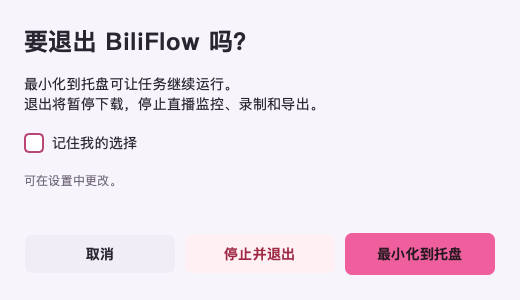

快捷键：Cmd/Ctrl+L 返回单个解析并聚焦来源输入；Cmd/Ctrl+1、2、3、4 分别进入下载、直播、任务和设置。设置快捷键为 Cmd+,（macOS）或 Ctrl+,（Windows）。多行批量输入中的 Enter 仍用于换行，菜单或弹窗中的 Esc 用于取消。

侧边栏提供「视频下载」「直播录制」「任务中心」，分隔线下方是「设置」；底部固定深浅模式和账号入口。窗口宽度低于 1120px 时，侧栏收为图标栏；悬停可查看入口名称。页面切换保留输入、解析结果、筛选和选择，下载与录制持续运行。底部活动数量可直接跳转到下载队列或当前录制。

视频下载提供「单个解析」「批量导入」两个页签，任务中心提供「下载队列」「当前录制」「录制历史」「下载文件」。加入下载队列后保留当前页，便于连续添加；成功提示中的「查看任务」可进入任务中心。下图均为离线演示数据。

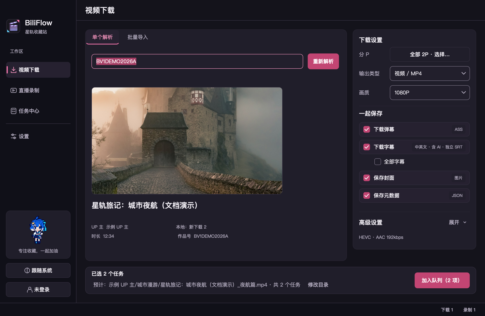

完整深浅主题、三种窗口尺寸和关键状态截图见[视觉规范与验证](UI_DESIGN.md)。

## GUI 工作流

<a id="开发版下载与归档优化未发布"></a>

### 下载与归档优化

开发分支的界面精修尚未发布：空间不足时，次要按钮进入所在区域的「更多」，选择栏使用「选择操作」；操作数量及筛选外选择仍保持显示。主操作、取消和停止保持可见，必要时分行。一般配置说明可悬停查看，错误与撤销入口继续保留；长路径可选中复制完整值。鼠标悬停只改变底色，Tab／方向键操作会显示完整的内缩焦点框。详见[本轮验收](UI_FEEDBACK_VALIDATION.md)。

以下功能从 `v0.8.10b2` 起提供；建议升级到 [0.8.11 正式版](https://github.com/itsVicOC/bilibili-downloader/releases/tag/v0.8.11)，获得提示、悬停、窄窗口操作区与弹窗居中的进一步优化。

- **复用已有媒体**：清理下载任务不影响文件记录。重新导入时，后台按实际画质、编码、音质和媒体类型匹配；文件存在、可读取且未发生记录外的变化时可复用。规格未知、文件缺失或磁盘离线不会被当作已完整保存。当前采用精确规格匹配，不把 HDR、帧率和码率变体按数字大小混为一类。
- **补全附件**：点击完成任务或文件，在详情区选择「补全附件…」，也可使用「更多 → 补全附件…」可分别选择弹幕、字幕、封面和元数据。只处理缺失的附加内容，不重新传输或封装主媒体。原媒体不可访问时停止操作，先重新定位文件。需要额外媒体副本时明确选择「另存一份媒体」。
- **结果状态**：区分「媒体已保存 · 规格回退」「媒体已保存 · 附件待补全」和「已复用已有媒体」。规格用可读名称显示；可在详情查看原因，并通过对应操作继续处理。
- **严格匹配**：下载配置中选择「规格不满足时 → 停止该项」，也可在默认设置中开启。请求的画质、编码、音质不可用时，在媒体传输前停止该项；默认仍允许回退并提示。切换单个分 P 会后台刷新该分 P 的规格，批量范围在实际下载时逐项核对。
- **筛选和选择**：队列可搜索标题、BV 号、作者和文件名；批量预览可搜索标题、作者与来源。「勾选当前未保存项」按当前规格和所需附件核对并累加勾选当前搜索结果。搜索和筛选保留勾选，列表会显示筛选外的选择数量。「全选当前结果」累加当前可见项；「查看已选」临时展示全部已选，返回后恢复原筛选；「清空全部选择」清除全部勾选。有选择时处理所有已选（含筛选外），无选择时处理当前可见项，启动后范围固定。分 P 默认全部选择，点击摘要可搜索标题、勾选，或在「按序号添加」输入 `1–5,8`；错误输入和取消都不改变原范围。
- **自动重试**：仅网络类错误自动重新排队，最多三轮，间隔 30、60、120 秒；倒计时与计数跨重启保留。暂停或关闭自动重试可取消等待。权限、磁盘与风控错误需要按详情入口处理，手动重试会重置该轮预算。
- **封装进度**：显示 FFmpeg 实际处理进度，传输速度只用于媒体传输阶段。点播处理以十分钟无进展检测代替固定五分钟总时限。
- **核验与重新定位**：文件页保留快速存在检查；「更多 → 核验媒体轨道与时长」使用当前 FFmpeg 检查轨道和可解析时长，不代表逐帧解码或内容真实性校验。「重新定位整个目录…」先输入原根目录、选择新根目录并预览映射；全部目标可读取后再统一更新记录，不移动文件。操作覆盖该根目录下的全部已登记文件，包括隐藏记录。
- **命名**：高级命名区可一键应用默认分 P、作者归档、番剧目录模板，或点击「插入字段…」。先选择常用模板，再看目录及文件名预览，需要时展开「高级编辑」。字段面板可搜索中文名称、用途或占位符，每项显示用途和示例，英文占位符作为次要信息；确认后插入原光标或选区。替换常用模板可「撤销替换」，保存设置后才应用。更改只影响新任务，已有任务的路径快照不变。

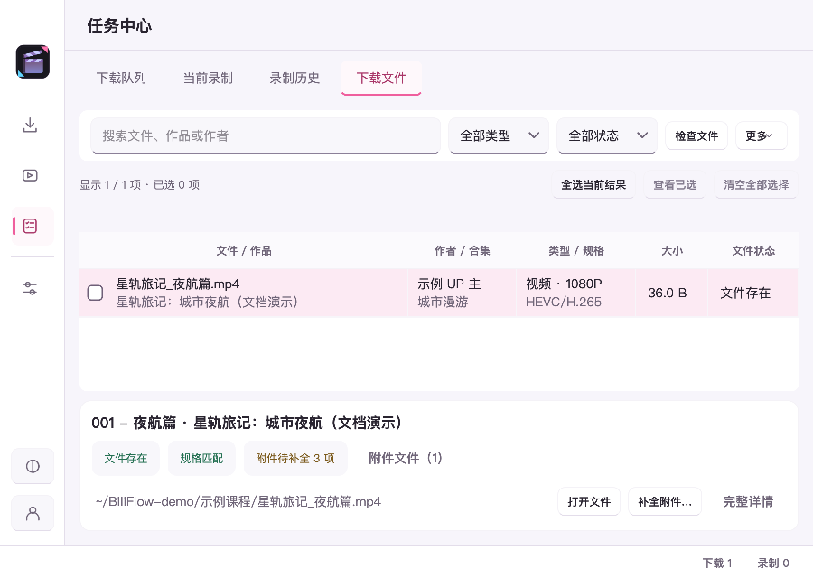

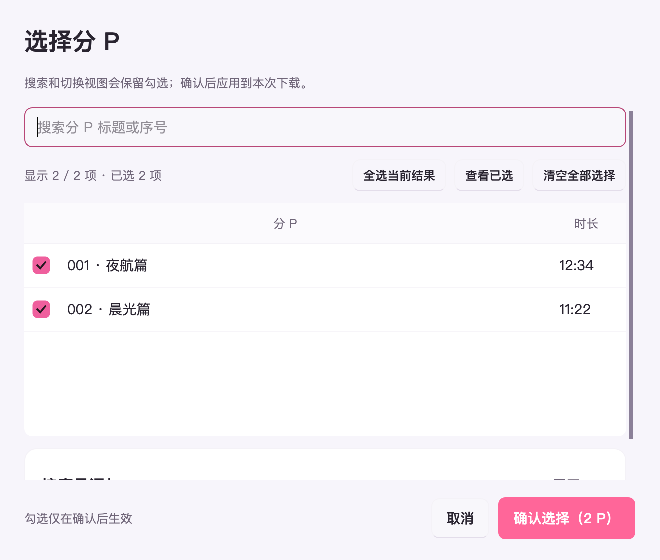

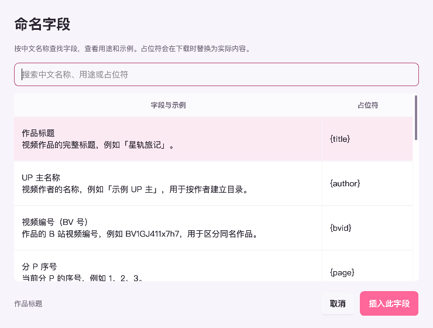

完整测试边界、原生前后截图与平台验收状态见[流程精修验收](WORKFLOW_POLISH_VALIDATION.md)。

### 解析与下载

1. 在「视频下载 → 单个解析」输入框粘贴 BV/AV/ep 号、完整视频/番剧单集链接或 b23.tv 短链。`ss/md` 请使用批量导入。
2. 点击“解析”，等待作品资料卡和可用规格更新。
3. 多 P 视频可选择某一分 P 或全部分 P，再选择画质与编码。需要时勾选“下载弹幕”或“下载字幕”。
4. 点击“加入队列”，查看新增数量和重复项提示。当前解析结果与规格会保留；修改来源后需重新解析才能加入。
5. 在「任务中心 → 下载队列」查看进度、速度、预计剩余时间和状态。选中任务可读取完整错误、警告与保存路径。运行中任务可以暂停并保留断点；暂停和失败任务可以继续或重试。完成后可打开文件目录或只清除任务记录。

未解析时，页面以「喜欢的这一集，留在身边。」和链接输入为中心，不展示空作品卡或禁用表单。下载设置先显示简短摘要，点击「修改」可提前选择输出与附件。收藏夹、合集、番剧季度或直播链接放错入口时，可通过提示切换并带入原链接；短链在后台展开后识别。

解析后作品封面和标题成为主要内容。工作区可用宽度达到 920px 时，作品与下载设置左右排列；更窄时上下排列，正文可滚动，底栏固定。分 P、输出类型、画质和附件直接展示；音频模式直接显示音质。视频编码、视频模式下的音质、显示比例及规格回退策略位于「高级设置」，收起后仍显示关键配置摘要。「全部字幕」仅在启用字幕后可选。

单个与批量共用同一份设置，切换页签或展开高级项不会重置选择。批量导入可直接修改配置，每个作品仍导入全部分 P；实际规格逐项确认。选择的规格在重新解析后仍可用时会保留，不可用时沿用既有可用项选择规则。

两种模式的固定底栏均显示任务数、保存位置、「修改目录」及「加入队列（N 项）」。完整配置在「高级设置 → 查看完整配置…」读取。未解析、来源已修改或未勾选批量作品时不能入队；解析失败会清除可提交结果，并在原位置显示原因与下一步操作。

当前布局与前后对照见[第二轮界面对照](images/ui-warm/index.html)。

直播继续使用固定操作卡；设置使用始终可见的 56px 紧凑保存栏，状态、撤销与保存位置固定。主操作位于右侧，房间信息和保存状态保留在左侧。页签与任务筛选工具栏具有独立底色，背景可见度较高时仍能清楚阅读；Tab 键移动到按钮时显示焦点边框。

任务行内展示暂停、继续、重试或打开目录。「更多 → 移除记录」保留文件与断点，可撤销。beta 2 通过行首复选框或空格键勾选，点击标题查看详情；Ctrl/Cmd+A 累加勾选当前结果。批量按钮有选择时只处理所选任务，没有选择时处理当前列表，并显示实际受影响数量。beta 2 切换筛选仍保留隐藏任务的勾选，并显示数量；0.8.10b1 的旧行为为取消隐藏选择。需要处理所有任务时，使用「更多」中明确标注数量的「暂停全部任务」「继续全部任务」「移除全部任务」，这些操作包含隐藏任务。

普通记录移除后直接提供「撤销」，提示消失后仍可在「更多 → 撤销移除」操作。涉及运行中或等待执行的下载时，确认一次「停止并移除」，随后统一显示停止进度；下载文件列表和断点保留。撤销后原运行中的任务保持暂停，停止时恰好完成的任务保留完成结果。工具栏在空间不足时自动换行。

### 分 P 命名与保存位置

新任务的多分 P 默认路径为 `作品标题/001 - 分P标题.mp4`，音频扩展名为 M4A 或 FLAC；空分 P 标题使用 `P序号`。长作品总标题只截短目录名，不再挤掉分 P 文件名。设置中的普通视频、多分 P 和番剧模板分别生效，目录层级使用 `/` 分隔；`{page_padded}` 为至少三位的分 P 序号。单个解析显示实际目标路径，批量预览显示展开后的任务数和路径示例，悬停作品可查看该作品的路径。

保存目录、命名模板和媒体格式在入队时固定。更改全局设置只影响新任务；已有任务继续和重试使用原目录与断点。旧版本未记录目录的任务在升级时固定为当时的保存目录，已完成文件使用记录中的实际位置。旧自定义命名模板继续用于多分 P；已有文件不会自动改名或移动。

### 下载文件

「任务中心 → 下载文件」独立保存已下载媒体及已登记附件。清除下载任务后，这里的文件记录仍保留；新下载（含 CLI 下载）自动登记，首次启动会导入保留的已完成任务。旧任务的附件只有在完整下载结果或匹配的 `.info.json` 中有记录时才导入，普通同名文件不会自动认作附件。列表显示媒体类型、实际规格、大小和文件状态，未知规格显示为未知。

文件页点击文件可查看紧凑详情，常用的打开、补全附件、重新选择位置放在该文件的上下文中；右键提供打开文件夹，工具栏保留「检查文件」与低频维护操作。检查有选择时处理所选下载及附件，没有选择时处理当前列表；显示文件进度，可取消。检查期间仍可搜索、筛选和打开文件，修改记录或回收操作等待检查结束。父目录离线或无法访问时显示「无法访问」，不会把整批文件判断为丢失；检查只验证存在及可读取情况，不代表音视频完整性验证。

列表支持按文件、作品、分 P、作者、合集和完整路径搜索，并按类型和文件状态筛选。空列表可点击「去下载」，无匹配结果可「清除筛选」，加载失败可重试。窄窗口优先显示文件名和规格，完整路径放在可复制的详情中。有附件时可展开「附件」，双击打开附件，或右键复制路径、打开文件夹及重新选择附件；主列表按钮始终针对主文件。

文件移动后可用「更多 → 重新选择文件…」更新记录中的位置，实际文件不会移动。缺失、无法访问和已回收分别提示重新选择文件、检查目录或磁盘连接、从系统回收站恢复后检查。批量结果仅显示简短数量摘要，完整路径和逐项原因通过「查看详情」读取。

- **移除任务记录**：清理下载队列，保留文件列表、媒体、附件和断点；可撤销最近一批。
- **移除文件列表记录**：保留实际文件，可通过提示或「更多 → 撤销移除记录」恢复本次运行最近一批。任务页和文件页的撤销各自独立，重启不保留撤销快照。
- **移入回收站**：确认文件和附件数量后逐项处理，可展开完整清单。共享引用、目录、符号链接及已变化的文件仍会跳过，原因列在处理详情中；不会自动永久删除。已回收文件不重复回收，使用系统回收站恢复后再检查状态。

文件已保存但记录尚未登记时，下次启动会自动重试；有待恢复记录或列表加载失败时，「更多」会显示「恢复文件记录」。媒体库及待恢复结果均纳入新版更新备份与回滚。

| 界面状态 | 含义 | 可执行操作 |
|---|---|---|
| 等待中 | 任务已保存，等待并发槽位 | 暂停 |
| 下载中 | 正在传输视频、音频或附加项 | 暂停并保留断点 |
| 已暂停 | 网络传输和 FFmpeg 已停止 | 继续、移除记录 |
| 合并中 | FFmpeg 正在无损封装媒体流 | 暂停会终止合并，继续后重新处理 |
| 完成 | 主媒体和所选附加项均完成 | 打开目录、移除记录 |
| 部分完成 | 主媒体成功，但存在需查看的警告 | 查看任务提示中的警告 |
| 失败 | 任务停止并保留可复用的断点 | 查看错误、修复原因后继续 |

批量导入接受每行一个视频、番剧 `ep/ss/md`、合集、系列或收藏夹来源。点击“解析并预览”后可以全选、取消全选或逐项筛选；番剧来源列会显示“系列 · 季度 · 章节”。已有同源作品会被标注，最终按视频分 P 或番剧剧集、媒体规格、输出相对路径和归档附加项精确去重。番剧整季中的单集失败不会中止其他任务。

批量导入位于视频下载工作台的第二个页签。解析成功后，来源自动收为一行摘要，为作品清单留出空间；点击「编辑来源」可展开修改，也可直接「重新解析」。作品清单支持「全选」「清空选择」和逐项勾选，同一来源不再重复显示来源列。

底部固定操作卡显示任务数与保存位置；下载设置在当前页直接修改，无需切回单个解析。来源文本变化后，旧预览会标记失效，重新解析前无法加入队列；部分解析失败时，统计和「查看未解析项」入口位于清单底部，成功作品仍可继续加入。全部来源失败时显示独立提示和详情入口。

批量解析显示当前来源、分页或作品读取阶段及数量；总量未知时显示不定进度。点击「取消解析」后，会在当前网络请求结束时停止继续请求，已解析作品与失败记录仍保留。共享下载设置显示目标规格，底栏显示保存目录，每个所选作品会导入全部分 P。

结果分别统计成功作品、跳过作品、失败来源和重复项；收藏夹中部分视频失效不等于整个收藏夹失败。「查看详情」优先展示可换行的失败原因，每行可复制链接，也可打开选中项的完整原因；仍可批量复制失败链接或仅重试失败项。重试会合并成功结果，并保留已有作品的勾选状态；修改来源使预览失效后，需要先重新解析。缺少作品编号的条目通过原来源重试。

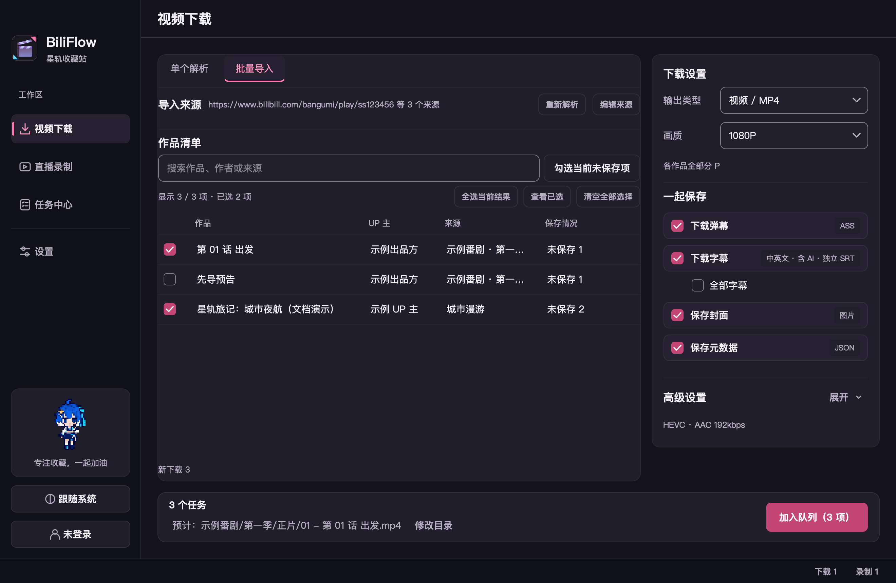

第一次真正加入下载任务时，GUI 会显示版本化版权确认。取消不会创建任务或临时媒体文件；提示内容发生实质变化后会再次要求确认。详见[版权与合规说明](COPYRIGHT.md)。

下载队列顶部可按进行中、已暂停、已完成或需要处理筛选。批量操作优先处理所选任务；未选中时处理当前列表。全部任务操作在「更多」中单独提供，按钮显示受影响数量。暂停停止网络传输和 FFmpeg 并保留断点；继续会处理范围内已暂停、失败或已取消的任务，重新获取有效流地址后续传。

「移除记录」「移除完成」只删除历史记录，不删除媒体文件或断点。本次运行可点击提示中的「撤销」恢复最近一次移除，包括状态、进度、警告与保存位置；已经创建相同任务时不会重复恢复。「打开目录」直接打开任务的保存目录。规格用紧凑标签展示，选中任务可查看完整内容。

选中下载任务或当前录制后，下方按名称、状态与进度、规格、保存位置和异常原因分层显示摘要；「完整详情」可打开并复制完整诊断信息。

「更多 → 清理下载缓存」会删除所有未完成断点，必须先暂停全部任务；统一设置的「工具与存储」也提供此入口。

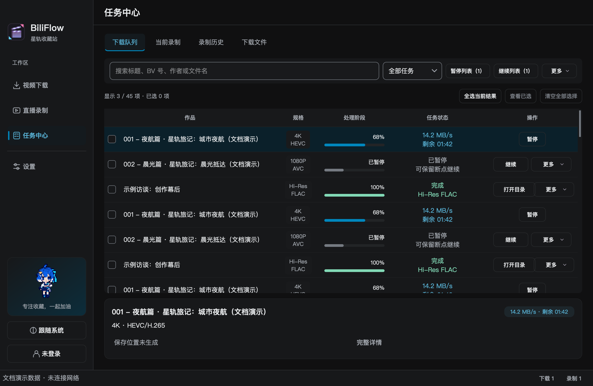

### 目录与任务反馈

单个与批量下载底部的「修改目录」紧随保存路径，长路径仍可选择、复制和查看完整提示。任务中心三个页签在指针移入任意列、进度或行内按钮时整行高亮；选中状态优先于悬停，不改变当前任务与详情。

录制历史支持整场移除：选中场次，在底部「更多」选择「移除场次记录」，也可右键操作。选中片段时显示「移除所属场次记录」，会一并移除所属场次的所有片段和导出记录。原始录制、MP4、目录、manifest 和直播订阅全部保留。正在录制、重连、收尾或等待／执行导出的目标不可移除，悬停入口可查看原因。

移除后可以点击底部提示的「撤销」，或「更多 → 撤销移除」，恢复本次运行最近一次成功移除的整场记录；下载队列的撤销独立保存。退出后撤销快照不保留，相同 ID 已存在时不会覆盖。

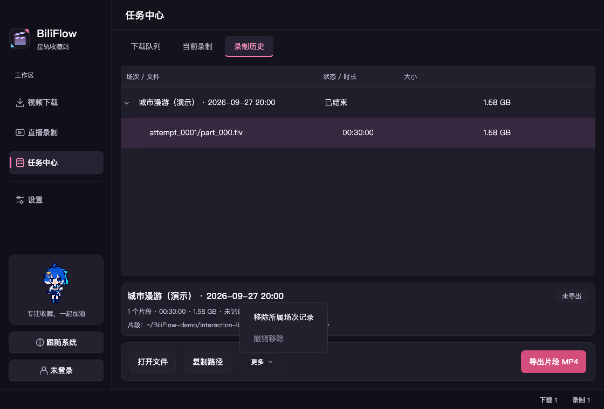

### 剪贴板来源识别

「设置 → 下载 → 来源识别」默认开启前台剪贴板识别，关闭后需保存设置。启动前已复制的内容、前台复制和切回软件时的当前文本都会检查；软件隐藏、最小化或处于后台时不读取剪贴板，也不会在后台联网解析。

识别到 BV／AV、ep／ss／md、B 站下载链接、b23.tv 短链、合集／系列／收藏夹或包含这些内容的分享文案后，工作区右上角显示确认条。单个作品点击「解析」，多个来源点击「批量解析」；解析区已有内容时显示「替换并解析」。确认前保留原输入及结果，确认后进入既有解析流程，不会自动加入下载队列。短链只在确认后展开；指向直播时提示前往直播页，不自动添加监控。

点击「忽略」后，同一剪贴板内容不再重复提示，直到内容发生变化。解析忙碌时仅保留最新候选，完成后仍需点击确认；离开设置时取消草稿确认会保留提示及草稿。图片、文件、直播间链接、鼠标选区和超过 64Ki 字符的文本不自动识别，仍可手动输入。

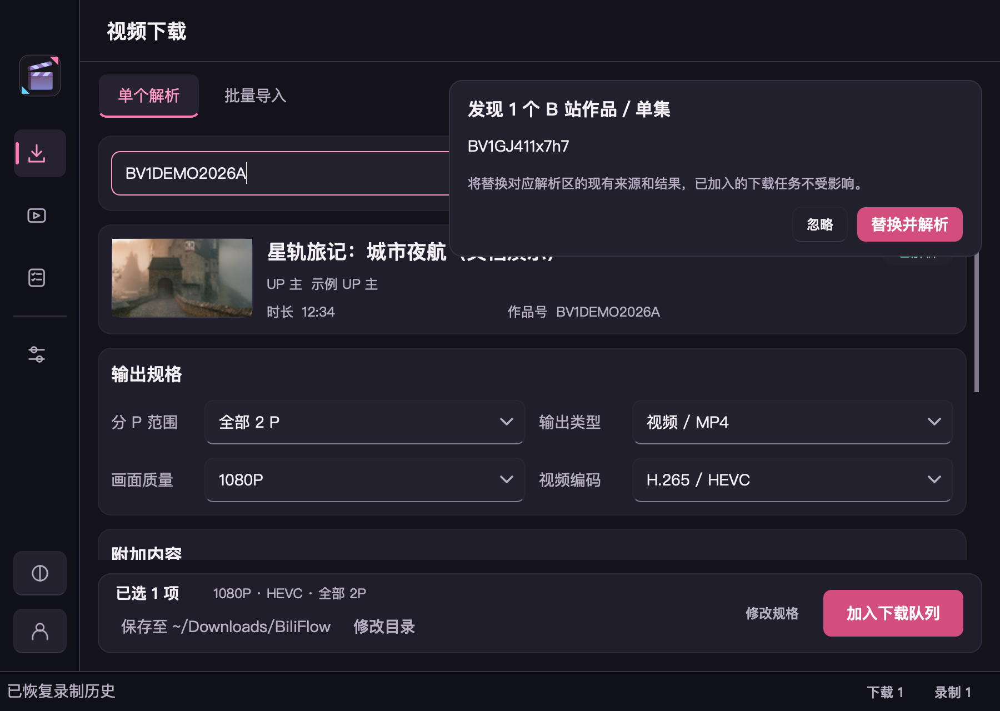

### 弹幕与字幕

以下导出改进从 [v0.8.4](../CHANGELOG.md#v084---2026-10-19) 起提供。弹幕保存为 ASS，字幕保存为 SRT；已有文件需要重新生成才会应用修复，媒体文件无需重新封装。

- 弹幕转换支持普通模式 1–6（正向、反向、顶部、底部）。高级、代码和其他特殊模式跳过并统计，不将其原始结构文本显示为普通弹幕。
- 普通反斜杠原样保留；字面量反斜杠 N/n/h 加入不可见分隔，避免被播放器解释为换行或空格。真实换行仍正常显示。为兼容不同 ASS 渲染器，正文花括号以全角 ｛ ｝ 显示；任务提示会说明兼容处理。
- 长弹幕按字素边界折行，避免拆开组合字符、ZWJ emoji 和旗帜；必要时缩小字号。超过 4096 个 Unicode 码点或缩小后仍无法放入画面的内容会跳过并提示。
- 根据文字宽度、字号与方向分配轨道，保证完整进出画面。极高密度下保留原时间和正文，任务会报告可能重叠的条数。
- 优先选择导出系统可用的中文字体。播放机器仍需有支持相应字符的字体；彩色 emoji 和罕见字符的字形取决于播放器及字体回退。
- 深色和浅色弹幕使用相应的对比描边，保留原文字颜色并提高复杂画面中的可读性。
- 时间按格式精度四舍五入：ASS 为百分之一秒，SRT 为毫秒。空白、非字符串、负数、非有限时间、结束早于开始等异常字幕条目会跳过，其他有效内容继续导出。
- 跳过、兼容处理和拥挤统计会进入任务警告，主媒体保留。没有任何有效内容或文件写入失败时，已有 ASS/SRT 不会被覆盖；保留的旧文件不代表本次更新成功。

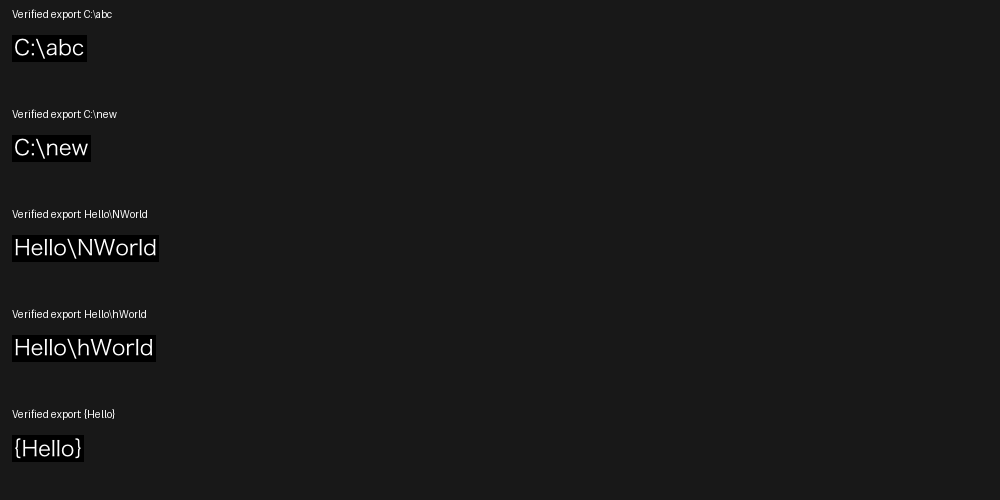

### 登录

登录不是普通公开视频下载的必要条件。需要会员画质或账号专属内容时，可打开“登录 B 站账号”，默认展示扫码登录，Cookie 输入保留为备用方式：

- 手动登录可以填写单个 `SESSDATA` 值或完整 Cookie 字符串；解析后只保留安全策略中列出的白名单字段，并要求存在 `SESSDATA`。
- 扫码登录依赖 Bilibili 当前接口，接口变化时可能暂时不可用。
- 登录凭据以 `auth-cookie-bundle-v1` 保存到系统凭据库，不会上传到项目维护者服务器，也不会发送给媒体 CDN。
- 凭据库不可用时，登录只在当前运行有效，Cookie 不会写入配置文件；重启后需要重新登录。
- 登录页显示账号名和会员状态，不显示 Cookie 内容。账号观看权限不等于复制、传播或商业使用授权。

登录后，侧栏左下角显示用户名与圆形头像，点击可管理登录或退出。窄窗口只显示头像，悬停可查看完整用户名、会员状态和 UID。头像在后台加载；加载失败时保留默认账号图标与用户名，不影响登录和下载。退出登录后清除显示的账号信息。

已登录时，账号入口先展示当前身份和退出操作，点击「切换账号」才展开登录方式；不会默认要求重新填写 Cookie。

不要把 SESSDATA 发送给他人，也不要粘贴到 Issue、日志或截图中。退出登录可在登录窗口清除凭据。

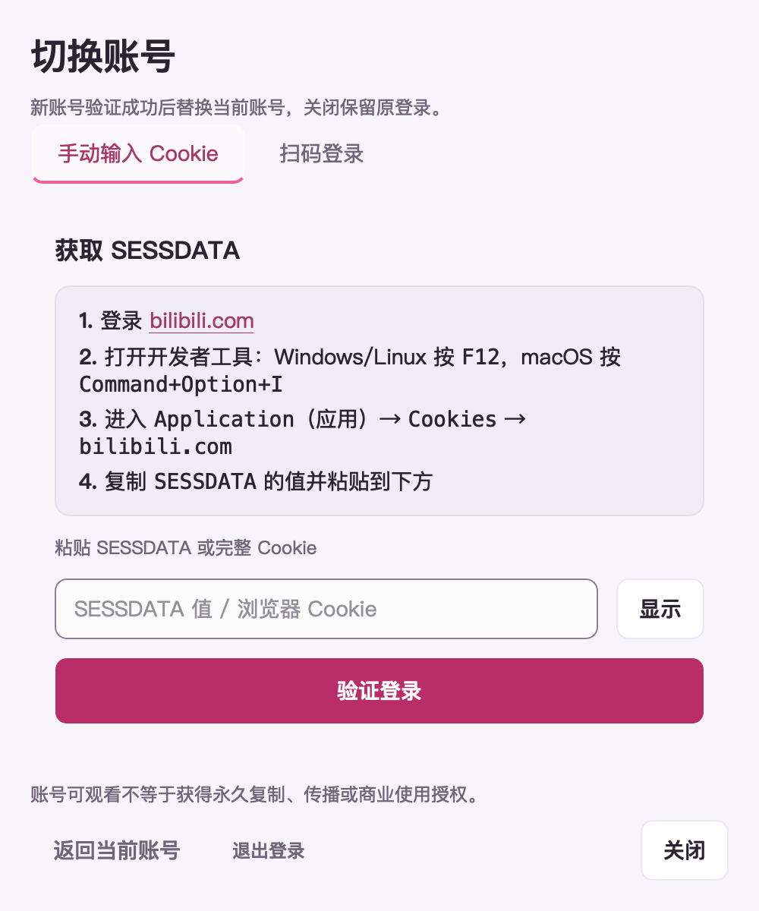

### 当前账号

点击侧栏底部账号可打开独立概览，查看头像、昵称、UID、会员和登录状态。昵称过长时悬停查看完整内容，UID 可选中复制。点击「切换账号」默认进入扫码，二维码完整显示，也可手动输入 Cookie；底部「返回当前账号」回到概览。验证新账号成功后才替换旧登录，返回或关闭会保留原账号。网络异常会保留已知身份并显示「暂时无法确认」，不直接视为退出登录。「退出登录」继续使用确认提示。

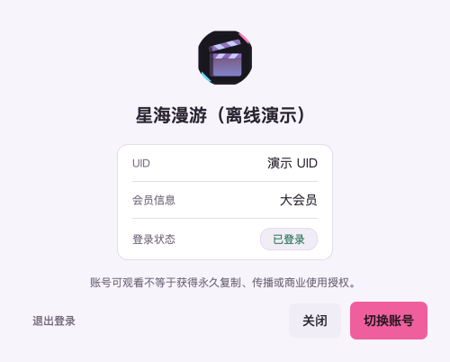

### 统一设置

侧栏主导航下方的「设置」包含「下载」「直播」「外观」「工具与存储」「关于与更新」五个分类，首次打开下载，之后保留本次访问的分类。除深浅模式即时保存外，修改保存在草稿中，点击底部「保存设置」后生效；「撤销修改」恢复已保存值。未保存离开时可选择保存、放弃或继续编辑。错误会显示在对应字段下方。

「设置 → 关于与更新」集中展示当前版本、功能说明和更新操作；Windows 的关闭方式位于「外观 → 窗口」。

「下载」页签包含以下选项：

- **输出目录**：默认是 `~/Downloads/bilibili`。
- **默认画质**：新解析任务的初始画质。
- **默认输出**：视频 MP4 或仅音频；普通音轨封装为 M4A，Hi-Res FLAC 保持 `.flac`。
- **默认音频**：AAC 64/192kbps、Dolby Atmos 或 Hi-Res FLAC；是否可用取决于视频和账号权限。
- **单视频命名**：控制普通单视频的目录和文件名，支持 `title`、`author`、`bvid`、`page`、`page_padded`、`part`、`part_suffix`、`collection`、`quality`、`codec` 字段。
- **多分 P 命名**：默认 `{title}/{page_padded} - {part}`，为作品建立文件夹，并使用至少三位序号保留分 P 顺序。
- **番剧命名**：独立控制番剧输出，支持 `series`、`season`、`section`、`episode`、`episode_number`。默认 `{series}/{season}/{section}/{episode_number} - {episode}`；缺失季度或章节时使用“本季”和“正片”，章节内集号为两位。
- **最大并发**：范围 1–8。网络或磁盘较慢时建议 1–3。
- **归档附加项**：控制弹幕、首选/全部字幕、封面和 JSON 元数据的默认状态。

「单视频命名／多分 P 命名／番剧命名」位于默认折叠的「高级命名与目录模板」。预览优先显示相对目录和文件名，悬停可查看、点击相邻按钮可复制完整预计路径，音频扩展名随音质更新；可展开「查看命名字段」查看说明。格式错误时会自动展开并定位。切换分类或折叠不会丢失草稿。例如 `{author}/{collection}/{title}{part_suffix}` 会按 UP 主和合集建立目录。标题等远端字段会逐段清理，不能通过模板写到输出目录之外。没有合集名称时，对应字段会使用 `untitled`，不需要合集目录时可从模板中移除 `{collection}`。

「直播」页签管理默认保存目录、并发录制、分段时长和保留空间。目录与分段默认值仅影响新添加的房间；已有房间请使用直播工作台中的「房间设置」。单房间画质在下次拉流时生效。

下载与直播的保存目录使用相同的只读选择框，可选中文字复制，通过「选择…」更改。更改目录保留为草稿，保存设置后生效；取消选择不改变原目录。

直播工作台在常规窗口并排显示监控列表与房间详情；窄窗口默认收起详情，可点击「展开」查看。底部持续显示当前房间和开始／停止操作；从任务中心定位房间时会展开其详情。

「工具与存储」页签分别展示 FFmpeg 与配套录制引擎的路径、检测按钮和检测结果，并提供下载缓存清理。FFmpeg 自定义路径优先级最高；留空时 full 包使用内置版本，lite 包和源码运行从系统 PATH 与常见安装位置查找。路径检查在后台运行，检查期间修改路径后需要重新检查；检测不保存其他草稿。

### 主题与工作区背景

在「设置 → 外观」通过两张预览卡选择「星河」或「晴海」。「星河」沿用粉紫星空；「晴海」以青蓝为强调色，在白色 / 炭灰表面上加入天空渐变、柔粉微光与轻盈波纹。侧栏底部和外观页可选择「跟随系统／日间／夜间」，立即生效并记住选择；手动模式不受系统变化影响，恢复跟随系统会立即同步当前模式。深浅模式不影响其他设置草稿，也不随「撤销修改」撤销。首次使用和旧配置默认保留「星河」，已有主题选择会随名称更新自动保留。点击「保存设置」后应用，无需重启，下次启动继续使用。

已选主题显示实线边框和「✓ 已选」。键盘焦点使用独立虚线外圈，Tab 移动焦点不会更改选择，按空格选择主题。

「玻璃效果 · 保存后生效」提供 0–40px 的模糊滑块，默认 18px。向左保留更多背景细节，向右使背景更柔和；下方示例随拖动实时变化，文字保持独立绘制。四个工作区共用同一模糊程度。点击「重置」恢复默认值，再保存设置生效。

玻璃模糊统一在外观页调节；选择背景窗口使用当前模糊草稿预览实际图片。点击「保存设置」才应用并记忆，保存失败保留草稿，「撤销修改」恢复上次保存的模糊值。

外观页将「显示模式 · 立即生效」与保存后生效的配色、背景分组展示。侧栏贯通顶部，右侧使用纯色紧凑页头。启用内置或自定义图片后，主要卡片采用液态玻璃风格：背景模糊、色彩透出、边缘高光与折射，文字保持清晰；没有图片时保留实色卡片。

侧栏左下角的小流会按电脑本地时间切换清晨（05:00–09:00）、上午（09:00–12:00）、午后（12:00–18:00）、傍晚（18:00–23:00）和深夜（23:00–05:00）五种状态，文案随之变化。十二套像素动画包含挥手、伸懒腰、翻书、喝饮料和打盹等，前台待机每隔 15～30 秒播放一套完整动作。隐藏、最小化或转入后台时暂停，回来后继续，跨时段时自动更新；素材完全离线可用。[查看动作预览](MASCOT_DESIGN.md)。

下载、直播、任务、设置四个工作区可以分别选择背景。点击「选择背景…」，可在「小流」与「自定义图片」间切换。内置图库提供日系插画、复古像素、轻绘水彩共 12 张作品，默认展示全部作品并将当前页面推荐作品排在前面，可按页面和画风筛选；所有作品都可以用于任意页面，安装后无需联网。

选择图片后可直接预览和调节深浅效果，点击「选用背景」保留到设置草稿，再点击「保存设置」应用。下载中的单个解析与批量导入共用一张图，任务和设置的各页签也共用所属工作区背景。「恢复默认」同样需要保存，「撤销修改」会放弃尚未保存的选图。可查看[十二张作品总览](images/backgrounds/xiaoliu-collection.jpg)与[设计及生成记录](BUILTIN_BACKGROUNDS.md)。

宽窗口中四区背景配置按两列显示。点击背景缩略图或「选择背景…」进入同一个选择窗口：宽窗口同时显示预览和图库，小窗口通过「浏览背景 / 预览效果」切换，保留当前选择。预览可切换「页面效果 / 原图」与「浅色 / 深色」。页面效果使用目标窗口比例的只读示例，不包含实际任务数据；自定义图片还支持拖放导入。在窗口内拖动「背景可见度」，向右更清晰：0% 隐藏图片，100% 显示原图。浅色和深色分别记忆，每个工作区独立设置；旁边的「重置」恢复当前模式的默认可见度。

预览实时显示调节效果。「选用背景」保留本次选图与调节，再点击设置页「保存设置」才应用到实际页面并记忆；取消或关闭预览不保留本次调节。「撤销修改」可恢复已保存值，保存失败时保留草稿和原外观。

支持静态 PNG、JPEG、WebP，原文件不超过 20 MiB、解码尺寸不超过 4000 万像素。图片会处理拍摄方向、等比缩至最长边 3840 像素，并保存不含原始元数据的应用内副本。原图移动或删除不影响已保存背景。

背景固定在主内容区域，居中等比填满并裁切，自动叠加与深浅主题匹配的遮罩。小流和自定义图片默认浅色可见度为 90%、深色为 80%，已有手动设置优先。大卡片和操作栏使用随背景取色的玻璃材质，空白区域直接展示背景；文字对比度自动保护，输入框、表头和数据行仍便于阅读。图片丢失或损坏时恢复默认显示，外观设置中会提示重新选图。

设置的五个分类在空白处和卡片间隙显示同一张背景，滚动时图片位置保持不变；底部保存栏保留清晰底色。

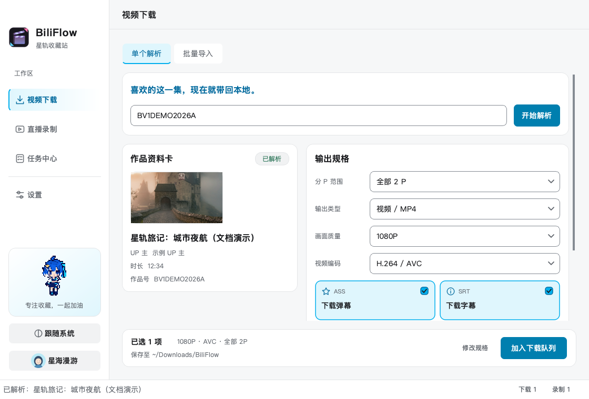


### 检查和安装更新

从 v0.8.3 起，版本查询、更新 ZIP 和校验清单优先使用官方镜像 `dl.1008.si`，网络失败时自动尝试 GitHub。镜像只提供已核对的发布附件；大小或 SHA-256 校验失败时停止安装。更新请求不携带 B 站 Cookie 或授权凭据。v0.8.2 及更早版本仍访问 GitHub，可从[官网](https://1008.si/download/)下载新版后手动安装以启用镜像。

「关于与更新」默认开启启动检查，默认通道为「仅正式版」；「最新版」包含 beta、rc 等预发布版。启动检查使用已保存设置，每次启动后台检查一次；「检查更新」使用当前选中的通道，不会保存其他草稿。自动检查失败不会弹窗，手动检查会显示结果或失败原因。

发现新版本时可以选择：

- **立即更新**：下载并验证 SHA-256，保持当前平台、架构和 full/lite 类型，安装后重启。
- **稍后提醒**：本次不安装，下次启动再次提醒。
- **跳过此版本**：只关闭这个版本的自动提醒，手动检查仍可查看和安装。

如果下载、录制或导出正在运行，更新包准备好后会再次确认。选择「停止任务并重启」会暂停下载并保留断点、完成录制收尾并保留文件、取消导出；选择「稍后重启」会保留下载包，可以在设置页点击「安装并重启」。普通退出不会安装更新。

自动安装支持官方 macOS、Windows 包。源码运行、Linux、缺少匹配包或安装目录不可写时，请使用「版本下载页」手动安装；已经下载的包可以通过「打开已下载更新包」打开。软件不申请管理员权限、不自动降级、不切换 full/lite。

更新程序会等待其他实例退出，保留旧程序及配置、任务数据库备份。新版启动确认失败时恢复旧版和数据，并在重新打开后说明原因。首次使用此功能需要先手动安装一个已包含更新功能的版本。

支持自定义背景的版本也会备份、恢复应用数据目录中的 `backgrounds/`，使背景副本与配置保持一致。手动备份或迁移配置时，请同时复制该目录。

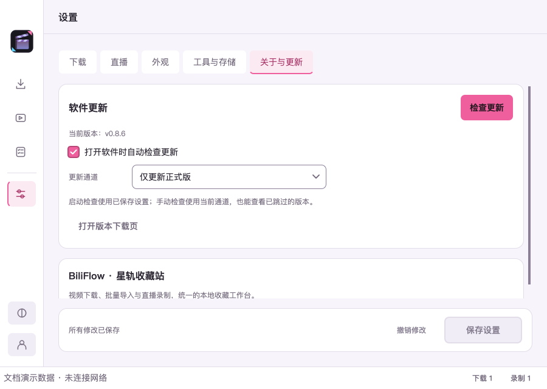

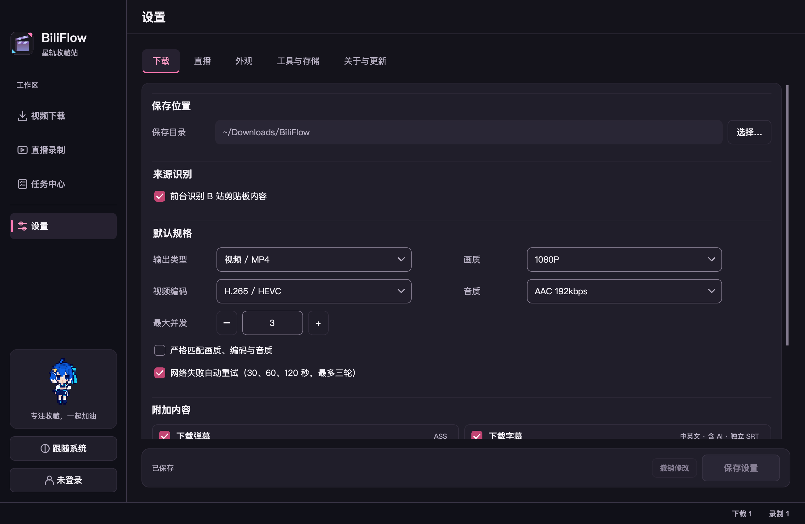

## CLI

查看命令：

```bash
python -m bilibili_downloader --help
python -m bilibili_downloader download --help
```

只解析视频信息：

```bash
python -m bilibili_downloader test BV1GJ411x7h7
python -m bilibili_downloader test av170001
python -m bilibili_downloader test "https://b23.tv/example"
python -m bilibili_downloader test ep123
```

下载：

```bash
python -m bilibili_downloader download BV1GJ411x7h7 \
  --quality 80 \
  --output ./downloads \
  --danmaku \
  --subtitle
```

番剧示例：

```bash
# 单集
python -m bilibili_downloader download ep123 --quality 80

# 整季默认只包含正片；显式加入 PV、特别篇和花絮
python -m bilibili_downloader download \
  "https://www.bilibili.com/bangumi/media/md123" \
  --include-extras \
  --metadata
```

| 参数 | 说明 |
|---|---|
| `source` | BV/AV/ep/ss/md、视频/番剧/合集/系列/收藏夹 URL 或 b23.tv 短链 |
| `-q, --quality` | Bilibili 画质代码，默认 `80` |
| `-o, --output` | 输出目录；省略时读取应用设置 |
| `-d, --danmaku` | 下载弹幕并转换为 ASS |
| `-s, --subtitle` | 下载字幕并转换为 SRT |
| `-c, --codec` | 视频编码：`7` AVC、`12` HEVC、`13` AV1 |
| `-p, --page` | 分 P 序号或 `all`；默认 `1` |
| `--subtitle-language` | 首选字幕语言代码；默认 `zh-Hans` |
| `--all-subtitles` | 下载该分 P 的全部可用字幕语言 |
| `--audio-only` | 只保存音轨并无损封装为 M4A；Hi-Res 音轨保存为 FLAC |
| `--audio-quality` | 音频代码，例如 `30280` AAC 192kbps、`30251` Hi-Res FLAC |
| `--cover` | 保存经过格式和大小校验的封面 |
| `--metadata` | 保存包含来源、作品和实际规格的 `.info.json` |
| `--path-template` | 覆盖本次下载的相对目录模板 |
| `--strict-match` | 严格匹配所请求的画质、编码与音质（beta 2 起） |
| `--force-new` | 明确另存媒体副本，跳过已有媒体复用（beta 2 起） |
| `--include-extras` | 番剧整季下载时包含非正片章节；默认关闭 |
| `--acknowledge-copyright` | 非交互环境首次下载时显式确认版权提示 |

CLI 首次下载时，交互终端会要求输入 `yes`。非交互终端必须传入 `--acknowledge-copyright`，否则以退出码 `2` 结束；确认版本会保存在设置中，无需每次重复。

画质代码：

| 代码 | 画质 | 代码 | 画质 |
|---:|---|---:|---|
| 6 | 240P | 16 | 360P |
| 32 | 480P | 64 | 720P |
| 80 | 1080P | 112 | 1080P+ |
| 116 | 1080P60 | 120 | 4K |
| 125 | HDR | 126 | Dolby Vision |
| 127 | 8K | | |

## 文件与配置

| 数据 | 默认位置 |
|---|---|
| macOS 配置 | `~/Library/Application Support/BiliFlow/config.json` |
| Windows 配置 | `%APPDATA%\\BiliFlow\\config.json` |
| Linux 配置 | `$XDG_CONFIG_HOME/biliflow/config.json`，未设置时使用 `~/.config/biliflow/config.json` |
| 损坏配置备份 | 与配置同目录的 `config.json.bak` |
| 持久任务数据库 | 与配置同目录的 `tasks.sqlite3` |
| 视频输出 | `~/Downloads/bilibili` |
| 登录凭据 | 系统凭据库；不可用时仅保留在当前进程内存 |

旧版 `~/.bilibili-downloader/config.json` 会在首次启动时复制到当前平台的原生配置目录，原文件会保留。

任务状态保存在 `tasks.sqlite3`。运行中退出或异常终止后，任务会在下次启动时显示为“已暂停”，无需重新粘贴链接即可继续。

应用在输出目录的 `.biliflow-parts/` 中保存媒体断点并支持 HTTP Range 续传。成功封装后会清理对应中间文件；暂停、网络中断或异常退出后，继续相同任务会复用已有数据。该目录可能占用较大空间，可在任务中心暂停全部任务后使用“清理缓存”。

同一媒体流可能包含多个 CDN 候选地址。BiliFlow 只连接受信任域名上的标准 HTTPS 目标；主地址不符合安全边界或暂时不可用时会自动尝试备用 CDN，不需要手动更换链接。

`.info.json` 使用 `schema_version: 2`，在既有来源、视频和产物字段之外记录内容类型、番剧/季度/媒体 ID、系列、季度、章节、集号和规范来源 URL。升级不会改写已有 `.info.json`。

文件名会移除当前操作系统不允许的字符。多 P 视频会在标题后追加分 P 序号和名称，避免互相覆盖。

## 升级与校验

- 从旧版本升级时可以直接替换应用；配置和登录凭据保存在应用包之外，不会随替换被删除。
- 首次启动新版本前，建议保留配置文件和未完成下载目录的备份。不要跨设备公开复制包含凭据的配置。
- 任务数据库需要迁移时会先创建 `tasks.sqlite3.bak`。完整性检查确认损坏的数据库会被隔离并在状态栏提示文件名；来自更新版本的数据库不会被旧版应用降级修改。
- Release 提供 `SHA256SUMS.txt`。macOS/Linux 可运行 `shasum -a 256 <安装包>`，Windows PowerShell 可运行 `Get-FileHash <安装包> -Algorithm SHA256`，并与校验文件中的对应记录比较。
- 跨大版本升级后若界面或设置异常，先退出应用并按“文件与配置”中的路径备份、移走 `config.json`，再重新启动生成默认配置。

## 限制与合规

- Bilibili 接口和鉴权规则可能变化，扫码登录、合集分页及部分画质可能因此失效。
- DRM、付费课程、地区受限、试看和平台未提供完整未加密流的内容无法下载。
- 本工具不会绕过账号权限。账号可观看不自动等于拥有复制、传播或商业使用权；请遵守[版权与合规说明](COPYRIGHT.md)、当地法律、服务条款与权利人许可。


## 0.8.11：字幕核验与 4:3 显示

- 在“视频下载 → 下载设置 → 高级设置 → 显示比例”选择“4:3 · 完整画面”。默认保持原始；纯音频不应用画面比例。
- 4:3 只改变播放器显示比例，像素尺寸和压缩媒体数据不变，不裁剪、不重新编码。已下载视频可从本地另存为 `.4x3.mp4`；原文件保留。
- 字幕通过签名播放器接口核对 BV/AV、CID 与轨道 ID。旧字幕缺少来源记录或被外部修改时，在“补全附件”中显示“待重新获取”；重新获取不重下视频。
- 新字幕转换完成后才替换旧文件；旧字幕保存在相邻的 `.srt.unverified.bak` 文件中，同名备份按序编号。查询或下载失败时不回退到旧字幕。
- 下载文件与便携元数据记录字幕来源、文件哈希及请求/实际显示比例。临时签名 URL 和 Cookie 不写入这些来源记录。
- 0.8.11 已正式发布；正式版与「最新版」两个更新通道均可升级，0.8.11 beta 用户也可升级。先退出旧应用、备份配置和任务库，再升级。高级隔离验证可用 `BILIFLOW_DATA_DIR` 指定独立数据目录。
